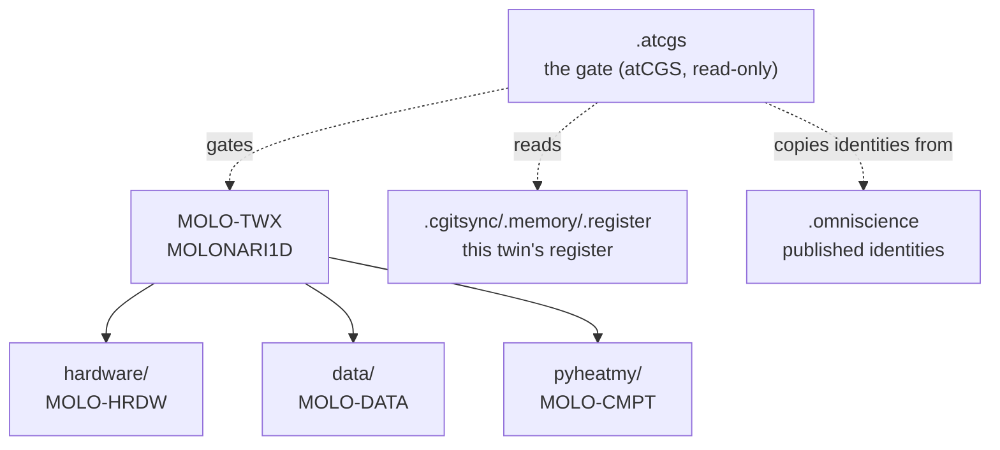

# atCGS — ComplexGraphSync 1.9.1-alpha

**atCGS is the gate of an Operating Space synchronised by ComplexGitSync.** You give it
a login and a password; it recognises who you are, which profile you hold, and which
Git repositories of the Operating Space that profile lets you read or write. Then it
runs ComplexGitSync (`cgitsync`) for you, with exactly those rights and nothing more.

`@cgs` is ComplexGitSync's identity manager: it wraps every `cgitsync` command the
way a decorator wraps a function. The command is the same; who may run it, and with
which keys, is decided by the gate.

Status: **alpha, working prototype.** Everything shown here was run on 2026-11-05 on
the real MOLONARI repositories. What is not built yet is listed in the
[reference](TUTOS/operator/REFERENCE.md#8-not-implemented-yet).

## 1. Digital twins made of Git repositories

atCGS gates **digital twins built only of Git repositories**. A twin is a tree of
repositories that ComplexGitSync installs, moves and records as one. Each twin carries
**its own memory**: a branch of a memory repository where every state of the tree is
recorded. That memory is the twin's state-space. So a twin is deterministic: from its
description (a `.cgs` file) and its memory, the same twin can be recomposed anywhere,
at any time, on any machine.

Twins compose. A large twin is made of smaller ones, the **subtwins**, each of which is
also a twin you can install and work on alone.

## 2. The example: MOLONARI

[MOLONARI](https://github.com/flipoyo/MOLONARI1D) is a river–groundwater monitoring
infrastructure. In atCGS it is four twins, all on branch `CGS-MOLO`:

| Twin | What it is | Repositories | Description |
|---|---|---|---|
| **MOLO-HRDW** | the hardware | `MOLONARI-hardware` | [`examples/molo_hrdw.cgs`](examples/molo_hrdw.cgs) |
| **MOLO-DATA** | the data | `MOLONARI-data` | [`examples/molo_data.cgs`](examples/molo_data.cgs) |
| **MOLO-CMPT** | the computation code (pyheatmy) | `MOLONARI-computo` | [`examples/molo_cmpt.cgs`](examples/molo_cmpt.cgs) |
| **MOLO-TWX** | the access point to every MOLONARI twin | `MOLONARI1D` + the three above | [`examples/molo_twx.cgs`](examples/molo_twx.cgs) |



Every twin mounts the same three things next to its repositories:

- **`.atcgs`**: atCGS itself, read-only. This is the gate you run.
- **`.cgitsync/.memory`**: the twin's memory, and in it the twin's **register**: who
  may do what on this twin.
- **`.omniscience`**: the identities known to atCGS, published by the operator,
  read-only.

A change pushed in MOLO-HRDW is the same commit MOLO-TWX sees in its `hardware/`:
the subtwin and the twin share the repository, not a copy.

## 3. Profiles and rights

Your profile on a twin is written in that twin's register. atCGS reads it when you log
in; you never choose it.

| Profile | Code | In a MOLONARI twin, it can | It cannot |
|---|---|---|---|
| **OPX** (operator) | `0000` | everything: install twins, admit users, publish identities, promote branches | — |
| **DEV** (developer) | `1000` | fetch, pull, commit, push, branch, merge on the repositories it is granted | write to the gate or the published identities; admit anyone |
| **USR** (user) | `1100` | fetch, pull, status | write anything |
| **PUB** (public) | `1111` | read what is public | log in |

**Identity is global, rights are local.** You register once with atCGS: every twin then
knows who you are. But you have no right on a twin until the operator grants it *in that
twin's register*. Being a DEV on MOLO-HRDW gives you nothing on MOLO-DATA.

Your ssh keys, one per repository, are sealed in your **GLYPH**, an 8 KiB file only your
login and password open. atCGS loads them into a private ssh-agent for one command and
kills it afterwards; it never uses `~/.ssh`.

## 4. Quick start

You need [Pixi](https://pixi.sh). Everything is `pixi run cgs …`, from a twin's `.atcgs`
folder.

```bash
# from nothing: no account, no key (TUTO 01 step 0)
git clone --branch CGS-ALPHA https://github.com/flipoyo/atCGS.git ~/atCGS
cd ~/atCGS
pixi install
pixi run cgs --help
pixi run cgs DEV login MOLO-HRDW status     # asks your login and password
```

The three tutorials take you from nothing to your first push on a MOLONARI twin:

1. **[Register](TUTOS/TUTO_01_REGISTER.md)**: from nothing (no profile, no key), become a user atCGS knows.
2. **[Emulate a twin](TUTOS/TUTO_02_TWIN.md)**: install MOLO-HRDW and MOLO-TWX, open their gates, get admitted.
3. **[Work through subtwins](TUTOS/TUTO_03_SUBTWINS.md)**: change MOLO-HRDW as a DEV, and see it in MOLO-TWX.

## 5. For operators and developers

- **[OPX 01](TUTOS/operator/OPX_01_FIRST_MISSION.md)**: found atCGS's own Operating Space and its master register.
- **[OPX 05](TUTOS/operator/OPX_05_SECOND_MISSION.md)**: the first run of a project under the gate (historical).
- **[OPX 02](TUTOS/operator/OPX_02_OPFRONTIER.md)**, **[OPX 03](TUTOS/operator/OPX_03_IDENTITY.md)**, **[OPX 04](TUTOS/operator/OPX_04_INTEGRATION.md)**: the levels, the identity internals, the checks.
- **[Reference](TUTOS/operator/REFERENCE.md)**: what runs, sessions, journals, GLYPH, what is not built, repository layout.

Developing atCGS itself happens in a workspace where `./ComplexGitSync` is checked out
next to it. There, `pixi run cgs` uses that live checkout (`@cgs/pixi.toml`); everywhere
else it uses the pinned ComplexGitSync. See the [reference](TUTOS/operator/REFERENCE.md#1-development-quick-start).
