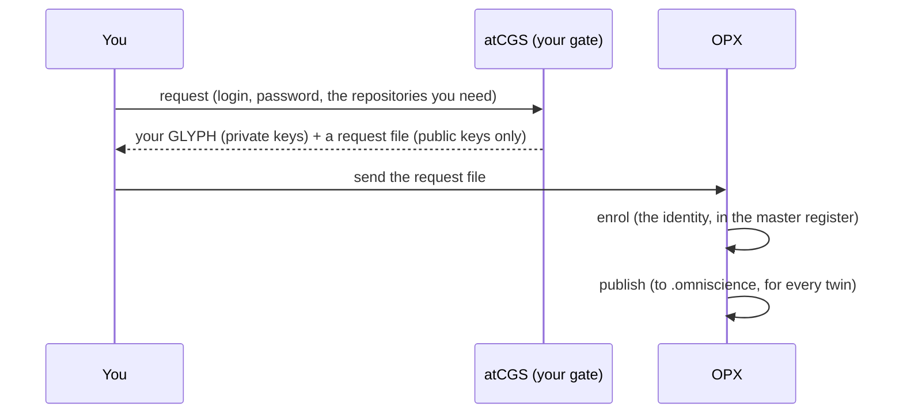

# TUTO 01 — Register: become a user atCGS knows

**Run on 2026-11-05** (atCGS 1.9.0-alpha), with a test DEV on MOLONARI's hardware twin.
The outputs are the real ones, shortened.

**Starting point.** Written for a new member of the MOLONARI team: you have no profile and
no key yet. The only things that exist are the **owner** and **OPX**, one operator, already
enrolled in atCGS's master register. Nobody else is known. Every repository is readable by
anyone over https, so you need no key to start: you create them here.

**What you get at the end:** an identity atCGS knows, and your ssh keys for the
repositories you asked for, sealed in your GLYPH. You do not yet have any right on a
twin: that is TUTO 02, where the operator admits you on a twin.

**Two people take part.** *You*, the new user, and *OPX*, the operator who runs the
gate. On a single machine you can play both; each step says who acts.

## What happens, in one picture



Your login and password never leave your machine. From them atCGS computes a key pair;
only the public half, and a hash of it (your **UID**), are ever written anywhere.

## Step 0 — You: start from nothing

You need two tools, no account and no ssh key.

1. [Pixi](https://pixi.sh) (it brings Python and everything else) and `git`.
2. atCGS itself, over https. This is only a read-only copy of the program:

```bash
git clone --branch CGS-ALPHA https://github.com/flipoyo/atCGS.git ~/atCGS
cd ~/atCGS
pixi install
pixi run cgs --help        # prints the usage: you are ready
```

You do **not** need a MOLONARI twin installed yet (that is TUTO 02, and it needs the
rights you are about to ask for). Run every `pixi run cgs …` of this tutorial from `~/atCGS`.

## Step 1 — You: choose your login and password

Nothing is typed here: you decide two things now, and write them down in your password
manager before step 2. atCGS has no account, no server and no "forgot password": your
identity **is** the pair, and the same pair always gives the same identity.

**Login**: any non-empty text, e.g. `ada.lovelace` or `ada@molonari`.
- It is not secret (it is only mixed into the key as a salt), and it is not checked
  against anything: no e-mail, no GitHub name.
- Pick one that is yours alone and that you will recognise: OPX will see your UID, not your
  login.
- Case and spaces count: `Ada` and `ada` are two people, and so is `ada ` with a trailing space.

**Password**: a long passphrase, at least four unrelated words or about 20 characters.
- It is the secret. Anyone who has your login and password has your identity and all
  your keys; atCGS cannot revoke a password, only a UID (OPX `revoke`).
- It is not stored, anywhere, and nobody can recover it. If you lose it, you start over
  with a new pair (a new UID, new request, new grants).
- Reuse none of your other passwords.

**What to expect when you type them** (step 2):
- Nothing is shown while you type, neither the login nor the password. The request asks
  for the password **twice**: that is your only protection against a typo.
- Commands later (`login`, step 7 of TUTO 02) ask them once, with no confirmation. A typo
  there is not an error: it is another identity, and you see `this UID holds no grant`.
  Retype slowly.
- Each time takes under a second and 256 MiB of memory: that cost is the protection.
  On a very small machine it can fail with a memory error.

**Check it later**: step 2 prints your `uid`. Note it. From then on, if a command shows
another `uid`, you mistyped the login or the password.

## Step 2 — You: ask for your keys

From your `~/atCGS`, name each repository you need and the profile you ask for on it.
`request` needs the file to write, then **pairs** `REPOSITORY PROFILE`; the file alone
is refused:

```bash
cd ~/atCGS
pixi run cgs DEV request ~/dev-hrdw.json \
  github:flipoyo/MOLONARI-hardware DEV \
  github:flipoyo/.memory DEV \
  github:flipoyo/atCGS USR \
  github:flipoyo/omniscience USR
```

It asks `DEV login:`, `DEV password:` and the password again, then prints:

```json
{
  "uid": "e9b6c66e4af7f6896fcba9ae40dae7302c79da03e7e96e8d68bb226f55d501b3",
  "glyph": "/home/you/.cgs/.glyph/e9b6c66e….glyph",
  "request": "/home/you/dev-hrdw.json",
  "keys": [
    { "repo": "github:flipoyo/MOLONARI-hardware", "role": "DEV", "fingerprint": "SHA256:Y31s0f…" },
    { "repo": "github:flipoyo/.memory",           "role": "DEV", "fingerprint": "SHA256:VqT7pK…" },
    { "repo": "github:flipoyo/atCGS",             "role": "USR", "fingerprint": "SHA256:HqwTmd…" },
    { "repo": "github:flipoyo/omniscience",       "role": "USR", "fingerprint": "SHA256:OF2nX3…" }
  ]
}
```

Why these four, for a developer of the hardware twin:

| Repository | Asked as | Because |
|---|---|---|
| `MOLONARI-hardware` | DEV | it is the code you work on: read and write |
| `.memory` | DEV | the twin's memory; every push records the twin's state there |
| `atCGS`, `omniscience` | USR | the gate and the published identities: you read them, never write them |

Write the request file **outside any repository** (here `~/`). It holds your UID, your
public key, a proof that you hold the private one, and the public halves of your ssh
keys: nothing secret. Your GLYPH stays in `~/.cgs/.glyph/` and never leaves your machine.

## Step 3 — You: send the request file to OPX

By any channel: e-mail, a chat, a USB key. It is public.

## Step 4 — OPX: enrol your identity

In the operator's own workspace (the one holding atCGS's **master register**, see
[OPX 01](operator/OPX_01_FIRST_MISSION.md)):

```bash
ATCGS_AUTHORIZE=OPX pixi run cgs OPX enrol ~/dev-hrdw.json
# { "uid": "e9b6c66e…", "enrolled": true, "next": "OPX publish, then OPX admit REQUEST from the twin's gate" }
```

`enrol` writes your identity, signed by OPX, and **grants nothing**. Only the master
register enrols; a twin's register refuses to.

## Step 5 — OPX: publish the identities

```bash
ATCGS_AUTHORIZE=OPX pixi run cgs OPX publish
# { "published": true, "branch": "CGS-MOLO", "lines": 2, "head": "…" }
```

The list of known identities (UIDs and public keys, no names) goes to
`.omniscience/atcgs/identity.jsonl`. Every twin copies it into its own register the next
time someone logs in or is admitted there.

## Done

You are a user atCGS knows. Next: [TUTO 02](TUTO_02_TWIN.md), where OPX gives you your
rights on a twin and you install your own copy of it, still without any key of your own.

## If something goes wrong

| You see | Why | Do |
|---|---|---|
| `unsupported @cgs DEV argument: 'request'` | `request` got no `REPOSITORY PROFILE` pair | `request OUT REPO ROLE [REPO ROLE …]`, as in step 2 |
| `the two passwords differ` | a typo in the confirmation | run `request` again |
| `"enrolled": false, "reason": "already known"` | this identity was enrolled before | nothing: go to publish |
| `enrolling … is done in the master register` | `enrol` was run from a twin's gate | run it in the operator's workspace |
| a different `uid` than expected | another login or password | the pair of step 1, exactly |
