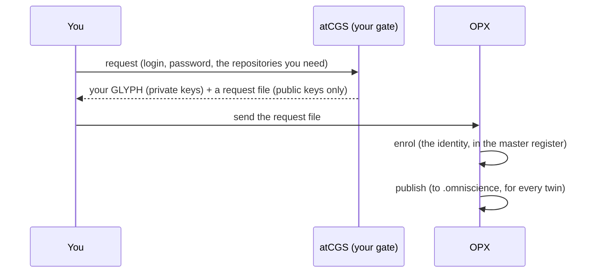

# TUTO 01 — Register: become a user atCGS knows

**Run on 2026-11-05** (atCGS 1.9.0-alpha), with a test DEV on MOLONARI's hardware twin.
The outputs are the real ones, shortened.

**What you get at the end:** an identity atCGS knows, and your ssh keys for the
repositories you asked for, sealed in your GLYPH. You do not yet have any right on a
twin: that is TUTO 02, where the operator admits you on a twin.

**Two people take part.** *You*, the new user, and *OPX*, the operator who runs the
gate. On a single machine you can play both; each step says who acts.

## What happens, in one picture



Your login and password never leave your machine. From them atCGS computes a key pair;
only the public half, and a hash of it (your **UID**), are ever written anywhere.

## Step 1 — You: choose your login and password

Pick them once and keep them. **Nothing stores them and nobody can recover them**: the
same pair always gives the same identity, a different pair gives a different person.
Use a long passphrase.

## Step 2 — You: ask for your keys

From any atCGS (for MOLONARI, the gate `.atcgs` of an installed twin), name each
repository you need and the profile you ask for on it:

```bash
cd ~/.cgs/MOLO-HRDW-<timestamp>/.atcgs
pixi run cgs DEV request ~/dev-hrdw.json \
  github:flipoyo/MOLONARI-hardware DEV \
  github:flipoyo/.memory DEV \
  github:flipoyo/atCGS USR \
  github:flipoyo/omniscience USR
```

It asks `DEV login:`, `DEV password:` and the password again, then prints:

```json
{
  "uid": "e9b6c66e4af7f6896fcba9ae40dae7302c79da03e7e96e8d68bb226f55d501b3",
  "glyph": "/home/you/.cgs/.glyph/e9b6c66e….glyph",
  "request": "/home/you/dev-hrdw.json",
  "keys": [
    { "repo": "github:flipoyo/MOLONARI-hardware", "role": "DEV", "fingerprint": "SHA256:Y31s0f…" },
    { "repo": "github:flipoyo/.memory",           "role": "DEV", "fingerprint": "SHA256:VqT7pK…" },
    { "repo": "github:flipoyo/atCGS",             "role": "USR", "fingerprint": "SHA256:HqwTmd…" },
    { "repo": "github:flipoyo/omniscience",       "role": "USR", "fingerprint": "SHA256:OF2nX3…" }
  ]
}
```

Why these four, for a developer of the hardware twin:

| Repository | Asked as | Because |
|---|---|---|
| `MOLONARI-hardware` | DEV | it is the code you work on: read and write |
| `.memory` | DEV | the twin's memory; every push records the twin's state there |
| `atCGS`, `omniscience` | USR | the gate and the published identities: you read them, never write them |

Write the request file **outside any repository** (here `~/`). It holds your UID, your
public key, a proof that you hold the private one, and the public halves of your ssh
keys: nothing secret. Your GLYPH stays in `~/.cgs/.glyph/` and never leaves your machine.

## Step 3 — You: send the request file to OPX

By any channel: e-mail, a chat, a USB key. It is public.

## Step 4 — OPX: enrol your identity

In the operator's own workspace (the one holding atCGS's **master register**, see
[OPX 01](operator/OPX_01_FIRST_MISSION.md)):

```bash
ATCGS_AUTHORIZE=OPX pixi run cgs OPX enrol ~/dev-hrdw.json
# { "uid": "e9b6c66e…", "enrolled": true, "next": "OPX publish, then OPX admit REQUEST from the twin's gate" }
```

`enrol` writes your identity, signed by OPX, and **grants nothing**. Only the master
register enrols; a twin's register refuses to.

## Step 5 — OPX: publish the identities

```bash
ATCGS_AUTHORIZE=OPX pixi run cgs OPX publish
# { "published": true, "branch": "CGS-MOLO", "lines": 2, "head": "…" }
```

The list of known identities (UIDs and public keys, no names) goes to
`.omniscience/atcgs/identity.jsonl`. Every twin copies it into its own register the next
time someone logs in or is admitted there.

## Done

You are a user atCGS knows. Next: [TUTO 02](TUTO_02_TWIN.md), where a twin is installed
and OPX gives you your rights on it.

## If something goes wrong

| You see | Why | Do |
|---|---|---|
| `the two passwords differ` | a typo in the confirmation | run `request` again |
| `"enrolled": false, "reason": "already known"` | this identity was enrolled before | nothing: go to publish |
| `enrolling … is done in the master register` | `enrol` was run from a twin's gate | run it in the operator's workspace |
| a different `uid` than expected | another login or password | the pair of step 1, exactly |
