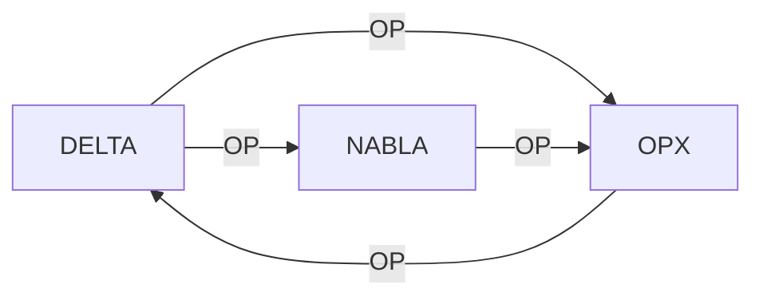

# TUTO 02 — PRIME G, *G, DELTA / NABLA

**Objectif :** interpréter les tuples sans en changer les quatre champs.

## 1. Grammaire

`PRIME G = {NAME, NODE, EDGE, OP}`.
Une ligne est un enregistrement, pas une instruction de clonage.
Les majuscules et les points initiaux sont significatifs.
Une chaîne peut apparaître plusieurs fois et dans des colonnes différentes.

## 2. BIOS initial (sept lignes)

```text
BIOS ENV HWX TWX
BOOT TWX POEX CGS
CGS POEX TWX GTS
GTS TWX OPX DEV
DEV HWX ENV USR
USR TWX GTS TWX
OPX HWX ENV TWX
```

La répétition du dernier `TWX` du tuple `USR` est préservée.
Ces lignes ne remplacent pas la variante BIOS ALPHA du tutoriel 01.

## 3. Extension de la topologie

```text
*G XGTS GX4G TWX
CGS-ALPHA GX4G CGS TWX
```

Le `*` indique une identité requestable, pas une connexion effective.
`XGTS` et `GX4G` demeurent des symboles sans service distant associé.
Une référence non résolue doit être indiquée comme non résolue.

## 4. DELTA / NABLA

```text
DELTA POEX NABLA OPX
OPX ENV PRIME DELTA
DELTA ENV PRIME NABLA
NABLA EDGE POEX OPX
```

`DELTA` figure deux fois, avec des valeurs différentes.
Une table indexée uniquement par NAME perdrait l'une de ces définitions.
La fixture conserve une **liste ordonnée**, jamais un dict par NAME.

## 5. Schéma du cycle déclaré



Le cycle est une propriété symbolique, pas une boucle exécutable certifiée.

## 6. Vérifier la fixture

```bash
python3 scripts/contract_check.py inspect
```

Exiger sept lignes BIOS, deux extensions et quatre lignes DELTA/NABLA.
Le nombre seul ne suffit pas : ordre et contenus doivent aussi concorder.

## 7. Cas de figure

La chaîne `GTS` est différente de l'extension `.gts`.
Le symbolique `PUB` désigne un layer, pas l'ouverture d'un dépôt Git.
`TWX` n'implique aucune horloge, permission ou protocole par défaut.
`HWX` n'implique aucun matériel particulier sans nouvelle spécification.

## 8. Expérience contrôlée

Sur une copie, échanger les champs EDGE et OP d'une ligne DELTA.
Attendre un refus par le validateur de fixture.
Rétablir l'ordre canonique et relancer l'inspection.
Refaire l'essai en supprimant la seconde ligne DELTA.
Elle doit être considérée comme une suppression de contrat.

## 9. Limites

Le graphe n'authentifie pas un détenteur de clé.
Le graphe ne prouve pas que ses GitRepos existent encore.
Le graphe ne définit pas un protocole UDP de résolution.
Le graphe n'identifie pas automatiquement un checkpoint L0.
La validation garantit ici seulement une représentation fidèle.

## 10. Résultat

```text
prime_g_fields = 4
bios_history = 7
extensions = 2
delta_nabla = 4
requestable_g_verified = false
```

Passer au tutoriel 03 pour les transitions de System Layers.

## Validation complémentaire : cas à automatiser

- Ligne 0: `BIOS` garde ses quatre champs.
- Ligne 0: `TWX` est OP, pas une action Git implicite.
- Ligne 0: le tuple `BIOS ENV HWX TWX` ne doit pas changer de position.
- Ligne 1: `BOOT` garde ses quatre champs.
- Ligne 1: `CGS` est OP, pas une action Git implicite.
- Ligne 1: le tuple `BOOT TWX POEX CGS` ne doit pas changer de position.
- Ligne 2: `CGS` garde ses quatre champs.
- Ligne 2: `GTS` est OP, pas une action Git implicite.
- Ligne 2: le tuple `CGS POEX TWX GTS` ne doit pas changer de position.
- Ligne 3: `GTS` garde ses quatre champs.
- Ligne 3: `DEV` est OP, pas une action Git implicite.
- Ligne 3: le tuple `GTS TWX OPX DEV` ne doit pas changer de position.
- Ligne 4: `DEV` garde ses quatre champs.
- Ligne 4: `USR` est OP, pas une action Git implicite.
- Ligne 4: le tuple `DEV HWX ENV USR` ne doit pas changer de position.
- Ligne 5: `USR` garde ses quatre champs.
- Ligne 5: `TWX` est OP, pas une action Git implicite.
- Ligne 5: le tuple `USR TWX GTS TWX` ne doit pas changer de position.
- Ligne 6: `OPX` garde ses quatre champs.
- Ligne 6: `TWX` est OP, pas une action Git implicite.
- Ligne 6: le tuple `OPX HWX ENV TWX` ne doit pas changer de position.
- Ligne 7: `*G` garde ses quatre champs.
- Ligne 7: `TWX` est OP, pas une action Git implicite.
- Ligne 7: le tuple `*G XGTS GX4G TWX` ne doit pas changer de position.
- Ligne 8: `CGS-ALPHA` garde ses quatre champs.
- Ligne 8: `TWX` est OP, pas une action Git implicite.
- Ligne 8: le tuple `CGS-ALPHA GX4G CGS TWX` ne doit pas changer de position.
- Ligne 9: `DELTA` garde ses quatre champs.
- Ligne 9: `OPX` est OP, pas une action Git implicite.
- Ligne 9: le tuple `DELTA POEX NABLA OPX` ne doit pas changer de position.
- Ligne 10: `OPX` garde ses quatre champs.
- Ligne 10: `DELTA` est OP, pas une action Git implicite.
- Ligne 10: le tuple `OPX ENV PRIME DELTA` ne doit pas changer de position.
- Ligne 11: `DELTA` garde ses quatre champs.
- Ligne 11: `NABLA` est OP, pas une action Git implicite.
- Ligne 11: le tuple `DELTA ENV PRIME NABLA` ne doit pas changer de position.
- Ligne 12: `NABLA` garde ses quatre champs.
- Ligne 12: `OPX` est OP, pas une action Git implicite.
- Ligne 12: le tuple `NABLA EDGE POEX OPX` ne doit pas changer de position.
- Ne jamais regrouper les tuples uniquement par NAME.
- L’identité `*G` signale la requestability, non la preuve.
- La table conserve le cycle DELTA/NABLA.
