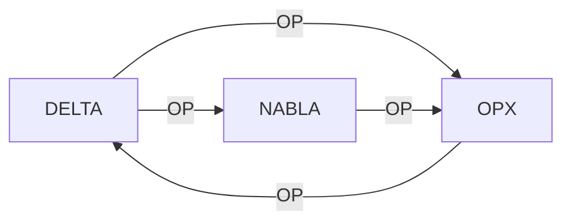

# TUTO 02 — PRIME G, *G, DELTA / NABLA

**Goal:** interpret the tuples without changing their four fields.

## 1. Grammar

`PRIME G = {NAME, NODE, EDGE, OP}`.
A line is a record, not a cloning instruction.
Capital letters and leading dots are significant.
A string may appear several times and in different columns.

## 2. Initial BIOS (seven lines)

```text
BIOS ENV HWX TWX
BOOT TWX POEX CGS
CGS POEX TWX GTS
GTS TWX OPX DEV
DEV HWX ENV USR
USR TWX GTS TWX
OPX HWX ENV TWX
```

The repetition of the last `TWX` of the `USR` tuple is preserved.
These lines do not replace the ALPHA BIOS variant of tutorial 01.

## 3. Topology extension

```text
*G XGTS GX4G TWX
CGS-ALPHA GX4G CGS TWX
```

The `*` indicates a requestable identity, not an actual connection.
`XGTS` and `GX4G` remain symbols with no associated remote service.
An unresolved reference must be reported as unresolved.

## 4. DELTA / NABLA

```text
DELTA POEX NABLA OPX
OPX ENV PRIME DELTA
DELTA ENV PRIME NABLA
NABLA EDGE POEX OPX
```

`DELTA` appears twice, with different values.
A table indexed only by NAME would lose one of these definitions.
The fixture keeps an **ordered list**, never a dict keyed by NAME.

## 5. Diagram of the declared cycle



The cycle is a symbolic property, not a certified executable loop.

## 6. Check the fixture

```bash
pixi run contract-inspect
```

Require seven BIOS lines, two extensions and four DELTA/NABLA lines.
The count alone is not enough: order and contents must also match.

## 7. Edge cases

The string `GTS` is different from the `.gts` extension.
The symbol `PUB` denotes a layer, not the opening of a Git repository.
`TWX` implies no clock, permission or protocol by default.
`HWX` implies no particular hardware without a new specification.

## 8. Controlled experiment

On a copy, swap the EDGE and OP fields of a DELTA line.
Expect a refusal from the fixture validator.
Restore the canonical order and rerun the inspection.
Repeat the test by deleting the second DELTA line.
It must be treated as a contract deletion.

## 9. Limits

The graph does not authenticate a key holder.
The graph does not prove that its GitRepos still exist.
The graph does not define a UDP resolution protocol.
The graph does not automatically identify an L0 checkpoint.
Here, validation only guarantees a faithful representation.

## 10. Result

```text
prime_g_fields = 4
bios_history = 7
extensions = 2
delta_nabla = 4
requestable_g_verified = false
```

Move on to tutorial 03 for System Layer transitions.

## Additional validation: cases to automate

- Line 0: `BIOS` keeps its four fields.
- Line 0: `TWX` is OP, not an implicit Git action.
- Line 0: the tuple `BIOS ENV HWX TWX` must not change position.
- Line 1: `BOOT` keeps its four fields.
- Line 1: `CGS` is OP, not an implicit Git action.
- Line 1: the tuple `BOOT TWX POEX CGS` must not change position.
- Line 2: `CGS` keeps its four fields.
- Line 2: `GTS` is OP, not an implicit Git action.
- Line 2: the tuple `CGS POEX TWX GTS` must not change position.
- Line 3: `GTS` keeps its four fields.
- Line 3: `DEV` is OP, not an implicit Git action.
- Line 3: the tuple `GTS TWX OPX DEV` must not change position.
- Line 4: `DEV` keeps its four fields.
- Line 4: `USR` is OP, not an implicit Git action.
- Line 4: the tuple `DEV HWX ENV USR` must not change position.
- Line 5: `USR` keeps its four fields.
- Line 5: `TWX` is OP, not an implicit Git action.
- Line 5: the tuple `USR TWX GTS TWX` must not change position.
- Line 6: `OPX` keeps its four fields.
- Line 6: `TWX` is OP, not an implicit Git action.
- Line 6: the tuple `OPX HWX ENV TWX` must not change position.
- Line 7: `*G` keeps its four fields.
- Line 7: `TWX` is OP, not an implicit Git action.
- Line 7: the tuple `*G XGTS GX4G TWX` must not change position.
- Line 8: `CGS-ALPHA` keeps its four fields.
- Line 8: `TWX` is OP, not an implicit Git action.
- Line 8: the tuple `CGS-ALPHA GX4G CGS TWX` must not change position.
- Line 9: `DELTA` keeps its four fields.
- Line 9: `OPX` is OP, not an implicit Git action.
- Line 9: the tuple `DELTA POEX NABLA OPX` must not change position.
- Line 10: `OPX` keeps its four fields.
- Line 10: `DELTA` is OP, not an implicit Git action.
- Line 10: the tuple `OPX ENV PRIME DELTA` must not change position.
- Line 11: `DELTA` keeps its four fields.
- Line 11: `NABLA` is OP, not an implicit Git action.
- Line 11: the tuple `DELTA ENV PRIME NABLA` must not change position.
- Line 12: `NABLA` keeps its four fields.
- Line 12: `OPX` is OP, not an implicit Git action.
- Line 12: the tuple `NABLA EDGE POEX OPX` must not change position.
- Never group the tuples by NAME alone.
- The `*G` identity signals requestability, not proof.
- The table keeps the DELTA/NABLA cycle.
