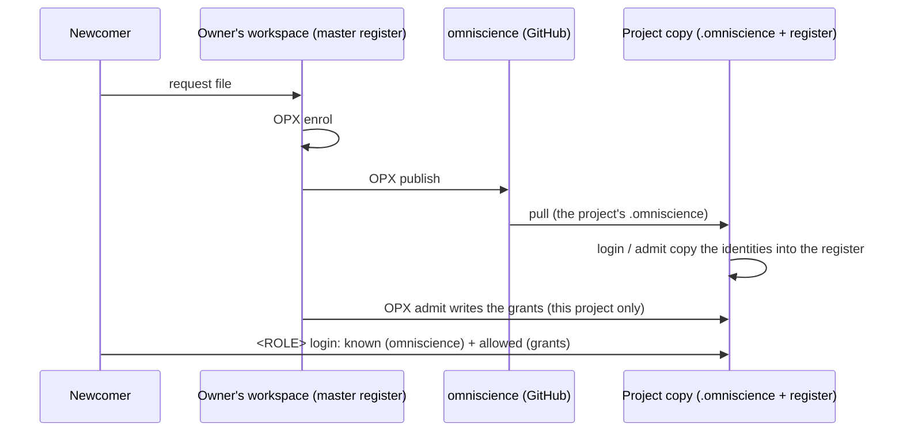

# TUTO 2 — Omniscience: how a project knows who you are

**atCGS 1.10.0-alpha, 2026-11-06.** This describes omniscience as it works today. Read
[TUTO 1](TUTO_1_OPERATE_A_PROJECT.md) first: it says when each command below is run.

## What it is, in three lines

- **omniscience** is one GitHub repository, `github:flipoyo/omniscience`.
- It holds the list of **identities** atCGS knows: who exists, not what they may do.
- The Owner writes it. Every project reads it, so a person enrolled once is known everywhere.

## What is in it

```text
omniscience/            branch CGS-MOLO (main later, when the development is validated)
└── atcgs/
    ├── identity.jsonl  one line per event: a person enrolled, or revoked
    └── identity.head   a fingerprint of the last line
```

One line of `identity.jsonl` holds:

| Field | Means |
|---|---|
| `uid` | the person's identity: a hash of their public key |
| `body.pub` | their public key |
| `body.proof` | proof they hold the matching private key |
| `op` | `enrol` or `revoke` |
| `seq`, `prev` | its place in the chain: each line points to the one before |
| `signer`, `sig` | the Owner's signature. A line not signed by the pinned OPX key is refused. |

**What it does not hold:** names, logins, passwords, private keys, or rights. Who may do
what in a project (its **grants**) stays in that project's own register, in
`.cgitsync/.memory/.register/access.jsonl`. It is signed like omniscience. Note: `.memory`
is public today, so anyone can read which UIDs hold which role on which repository (UIDs and
public keys only, no names).

## Who does what

| Who | Does | Command | When |
|---|---|---|---|
| Owner | writes the identities into omniscience | `ATCGS_AUTHORIZE=OPX pixi run cgs OPX publish` | after every `enrol` or `revoke <uid>` (TUTO 1, C5 and F) |
| atCGS (automatic) | copies them into a project's register | inside every `login` and `admit` | each time someone logs in or is admitted |
| Owner | brings a project's copy up to date before admitting | `pixi run cgs OPX login <PROJECT> pull` | just before `admit` (TUTO 1, C5: `onboard` does it) |
| Newcomer | checks that they are published | `grep` (below) | before asking to be admitted |
| Nobody else | writes omniscience | — | every key on it is read-only, except the Owner's |

## How it connects you to a project



To work in a project, two things must be true at once:

1. **You are known**: your `uid` is in omniscience, so it reaches the project's register.
2. **You are allowed**: the project's register holds a grant for you, at the level you log in with.

`login` checks both, in that order. The first gives `this login/password is not enrolled,
or was revoked`; the second gives `this UID holds no <ROLE> grant`.

## Newcomer: check you are published

In your copy of the project, the `.omniscience` folder is a read-only checkout of omniscience:

```bash
grep -c <your uid> ~/.cgs/MOLO-HRDW-<timestamp>/.omniscience/atcgs/identity.jsonl
# 1 or more: you are known.   0: the Owner has not published yet, or your copy is older.
```

Your copy is as old as your install. If you installed the project **before** the Owner
published, update the two folders. They are public: read them over https, as at install:

```bash
export GIT_CONFIG_COUNT=1 GIT_CONFIG_KEY_0=url.https://github.com/.insteadOf GIT_CONFIG_VALUE_0=git@github.com:
git -C ~/.cgs/MOLO-HRDW-<timestamp>/.omniscience pull
git -C ~/.cgs/MOLO-HRDW-<timestamp>/.cgitsync/.memory pull       # the grants (TUTO 1, C5)
```

Once you can log in, `pixi run cgs <ROLE> login MOLO-HRDW pull` keeps both up to date.

## Owner: publish

From your workspace:

```bash
ATCGS_AUTHORIZE=OPX pixi run cgs OPX publish
# { "published": true, "branch": "CGS-MOLO", "lines": 2, "head": "394ad2d5…" }
```

- It writes `atcgs/identity.jsonl` and `atcgs/identity.head` on branch `CGS-MOLO` and pushes
  them, with your own omniscience key. Your local `.omniscience` checkout does not move.
- Run it twice: the second time says `"published": false, "reason": "already up to date"`.
- It only runs in your workspace (the master register). From a project's gate it is refused.

## What protects it

- **Every line is signed by the Owner.** A project checks the whole file against the OPX key
  pinned in `spec/contracts.toml` before using it. One changed byte and it is refused.
- **A project never merges.** If a project's register holds a line omniscience does not, the
  project refuses: `differs from the published one: refused, not merged`. Fix: copy
  `.omniscience/atcgs/identity.jsonl` over the project's `.cgitsync/.memory/.register/identity.jsonl`.
- **A revocation spreads the same way.** `OPX revoke <uid>` in the workspace, then `publish`:
  each project refuses that person at the next `login` after its `.omniscience` is pulled.
  *Covered by a test; not yet run on a real project.*

## If something goes wrong

| You see | Why | Do |
|---|---|---|
| `this login/password is not enrolled, or was revoked: PUB` | your `uid` is not in the project's copy of omniscience, or a typo in your login or password | the `grep` above; retype slowly |
| `enrolling a new identity is done in the master register` at `admit` | the project's `.omniscience` is older than the `publish` | `OPX login <PROJECT> pull`, then `admit` |
| `differs from the published one: refused, not merged` | the project's register went its own way | copy the published `identity.jsonl` over it (above) |
| `no … checkout to publish through` | `publish` run where there is no `.omniscience` | run it in the Owner's workspace |
| `"published": false, "reason": "already up to date"` | nothing new to publish | nothing to do |

Internals: [REFERENCE](operator/REFERENCE.md) § 6.
