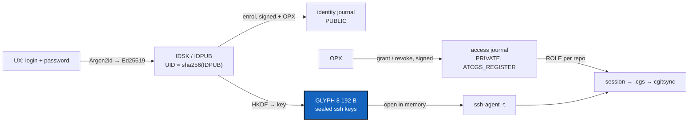

# IdentityJournals — login, password → public key; the GLYPH covers the ssh keys

*Created: 2026-11-03*

*Branch: CGS-ALPHA*

> **Owner direction — 2026-11-03:** *"I don't need the glyphs as identity; a
> classic ledger login, password → public-key is enough. Only the public key
> is registered. Then I want to use my GLYPH system for covering the ssh keys
> of the user. We need the keys for managing the GitRepo, which atCGS does
> among other things. The GLYPH is the cover of the ssh keys of the user."*
> And: *"I want to check how it works."*

## Abstract — read this first

**The one-line version.** Replace the 1.5 SEED/GLYPH identity (`poex`, `eopx`,
`Register`, `Cred`, `prove`) with the design in README § 3: an Ed25519 key
derived from login + password, two signed append-only journals (identity and
access), and a GLYPH that is the user's ssh keys sealed in 256×256 bits.

**Why.** In 1.5 the GLYPH is not a public key: it is derived from the SEED,
and a proof means presenting the SEED. `poex` re-checks an equality that
`sha256(GLYPH)` has already settled (`atcgs.py:539`). The register is keyed
by NAME, so names are stored. And the temporary `.cred` ssh key cannot reach a
real git remote, which accepts only keys registered in advance.

**How you check it works.** M0 is a single script, `pixi run identity-demo`,
that runs the whole flow on throwaway data and prints each step: enrol, grant,
seal, login, open, `ssh-add`, close. Read its output before anything else is
built. M5 goes further: a local `sshd` where DEV can push, USR can only fetch,
and a revoked key is refused.

**What you will find.** § 1 the target, § 2 milestones, § 3 decisions for the
owner, § 4 refusals, § 5 acceptance.

## 1. Target

README § 3 is the specification; this ticket does not restate it. In short:

| Piece | Module | Holds |
|---|---|---|
| Identity key | `atcgs/identity.py` | `derive(login, password) -> Identity(sk, pub, uid)` |
| Journals | `atcgs/journal.py` | JSON lines, `prev` hash chain, Ed25519 signatures, `verify()`, `state()` |
| GLYPH | `atcgs/glyph.py` | `seal(identity, keys) -> 8192 bytes`, `open(identity, glyph) -> keys` |
| Session | `atcgs/session.py` | the 8 steps of README § 3.6, as a context manager |

`atcgs.py` is one 630-line module today. Turning it into a package is part
of M1. Keep `python -m atcgs` and `@cgs` working, and keep `__version__`
where `tests/test_version.py` looks for it.

Crypto comes from the `cryptography` package only: `Ed25519PrivateKey`,
`Argon2id` (needs `cryptography >= 44`), `HKDF`, `ChaCha20Poly1305`. Before
M1, check that the conda-forge build for all three platforms in `pixi.toml`
includes Argon2id. If it does not, use `argon2-cffi` for the KDF alone.

## 2. Milestones

### M0 — Demo you can run (do this first)

`scripts/identity_demo.py`, Pixi task `identity-demo`. Everything goes in a
temporary directory that is deleted at the end. Nothing touches `~/.ssh`, the
real register or the network.

1. Create OPX (`opx` / fixed demo password) and two users, `alice` (DEV) and
   `bob` (USR). Print each UID, never the login.
2. Write the identity journal (3 `enrol`) and the access journal (2 `grant`).
   Print both files.
3. Generate one ssh key per user and seal it in a GLYPH. Print the GLYPH
   size, its sha256, and the first bytes as hex. Also write it as a 256×256
   PBM image, so you can *see* that it is noise.
4. Log in as alice: derive the key again, check the journal, sign a
   challenge, read her role, open the GLYPH, load the key into a private
   `ssh-agent` (its own socket, `-t 60`). Print `ssh-add -l` and check that
   the fingerprint matches the one in the access journal.
5. Negative cases, each with its refusal printed: a wrong password (unknown
   UID), one flipped GLYPH bit (tag failure), a grant signed by alice instead
   of OPX (ignored), bob after a `revoke` (PUB).
6. Close: `ssh-add -l` is empty, the agent is killed, the temporary
   directory is gone.

M0 may use the M1–M3 modules as they appear, or inline drafts of them. It
is the reference the later tests are written against.

### M1 — Identity key

- `derive()` with the README § 3.2 parameters. `ATCGS_KDF_PROFILE=test`
  switches to cheap parameters for CI only; the profile name is part of the
  salt, so a test key can never match a real one.
- Tests: deterministic; one changed character in login or password gives
  another UID; the password never appears in `repr`, exceptions or logs.

### M2 — Journals

- One entry = canonical JSON (sorted keys, no spaces) plus `sig` fields.
  `prev` = sha256 of the previous line's canonical bytes; the first entry
  has `prev = 0…0`.
- Ops: identity journal `enrol | rotate | revoke`; access journal
  `grant | revoke`. Signers as in README § 3.3–3.4.
- `verify()` walks the chain and refuses the whole file on the first bad
  link or signature. `state()` returns the active UIDs and the
  `(UID, repo) -> (role, fingerprints)` map.
- The OPX public key is pinned (D2) and is the only key that can sign a
  `grant`.
- Tests: tamper, reorder, delete a line, replay a line, wrong signer, grant
  for a revoked UID, rotate keeps the grants.

### M3 — GLYPH

- The exact layout of README § 3.5. The plaintext is a length-prefixed list
  of `(repo, role, OpenSSH private key)` entries, padded to 8 159 bytes.
- Tests: round trip; exactly 8 192 bytes; one flipped bit refused; wrong
  password refused; over capacity refused at seal time; the same keys sealed
  twice give two different GLYPHs (new nonce).

### M4 — Session and `@cgs` commands

- `Session` runs the steps of README § 3.6. It starts its own `ssh-agent` on
  a private socket, sets `SSH_AUTH_SOCK` only for the `cgitsync` subprocess,
  and kills the agent in `__exit__`, also on failure.
- New `@cgs` selectors: `OPX enrol`, `OPX grant UID REPO ROLE`,
  `OPX revoke …`, `<LAYER> login TWIN`. The password is read with `getpass`,
  never from argv or the environment.
- `login` writes the `.cgs` for the granted repos and nothing for the others.
- Tests: the agent is gone after an exception inside the session; no file
  written outside the Twin; `cgitsync` receives `SSH_AUTH_SOCK` and nothing
  else identity-related.

### M5 — Proof against a real ssh remote (optional, but it is the real check)

- `scripts/local_remote.py`: start `sshd` from Pixi's openssh on
  `127.0.0.1:<free port>`, as the current user, with a host key and an
  `authorized_keys` file *generated from the access journal*:
  - DEV → `restrict,command="git-shell -c \"$SSH_ORIGINAL_COMMAND\""`
  - USR → a forced command that allows only `git-upload-pack`.
- A bare repo in the temporary directory. Check: alice (DEV) can clone and
  push; bob (USR) can clone, and his push is refused; after `revoke`,
  regenerate `authorized_keys` and bob's clone is refused.
- This is the local version of "OPX installs deploy keys". The GitHub
  version is M7.

### M6 — Retire the 1.5 mechanism

- Remove `microcode/poex.c`, `microcode/eopx.c` and their tests, `POEX`,
  `EOPX`, `Register`, `Cred`, `Session.prove`, and `@cgs … prove`.
  `scripts/poex_4x256_simulator.py` and `candidate.json` go too, unless D6
  keeps them.
- `spec/contracts.toml` and `scripts/contract_check.py`: replace `[poex]`
  and `[eopx]` with `[identity]` and `[glyph]`. Settle what happens to the
  `KEY := sha256(GLYPH)` rows (D5).
- Docs: rewrite TUTO 05 for README § 3; mark TUTO 04 as legacy or drop it;
  update `microcode/README.md` and ALPHA.md.
- `pixi.toml`: add `cryptography`. Drop `c-compiler` if nothing compiles C
  any more.
- Version `1.6.0-alpha`, everywhere `test_version.py` checks.

### M7 — GitHub deploy keys (separate ticket once M5 passes)

OPX runs `gh api repos/{owner}/{repo}/keys` on `grant` and `revoke`.
GitHub refuses a key that is already a deploy key on another repo, which is
why the GLYPH holds one key per `(repo, role)`. Out of scope here; listed so
that M3's key layout is not chosen against it.

## 3. Decisions for the owner

| # | Question | Proposal |
|---|---|---|
| D1 | Key derived from login + password, or a random key in a password-protected keystore? | Derived, as you asked. The cost: anyone can guess passwords offline against the public `IDPUB` (README § 3.2). Revisit if that is not acceptable. |
| D2 | Where is OPX's public key pinned? | `spec/contracts.toml [identity] opx_pub`, not `POEX.cgs`: `cgitsync bootstrap` parses that file and should not meet unknown keys. |
| D3 | Where does a user's GLYPH live? | With the user (`~/.cgs/<UID>.glyph`); OPX keeps a copy in the register repo as a backup. Sealed, it is safe in both places. |
| D4 | Argon2id cost | `m = 256 MiB, t = 3` for real use; a `test` profile for CI (M1). |
| D5 | The 4-bit `.poe` codes and the `KEY` contract rows | Keep the codes as role codes (OPX `1000`, DEV `1100`, USR `1110`, PUB `1111`); drop `KEY := sha256(GLYPH)`. |
| D6 | Keep the 4×256 packet simulator as a lab tool? | Drop it with `poex`; the 256×256 format lives on in the GLYPH. |

Until decided, implement the proposal and leave the question in this table.

## 4. Refusals

- No login, name or password in any file, log, argv, environment variable
  or exception message.
- No ssh private key written to disk, except inside the M0/M5 temporary
  directory, which is deleted.
- No hand-written cryptography. The C microcodes are retired, not ported.
- No access decision inside `cgitsync`. It stays anonymous (README § 2).
- No GitHub call before M7.

## 5. Acceptance

- `pixi run identity-demo` runs from start to finish with no network, and its
  output shows each step of § 2 M0, including the four refusals.
- `pixi run test` is green, with M1–M4 tests. The test that already fails
  (`test_no_stale_version_literal`, missing `ComplexGitSync/AGENT.md`) is
  fixed or tracked separately.
- `grep -ri` for the demo logins and passwords over the journals, the GLYPHs
  and the register returns nothing.
- M5, if done: DEV pushes, USR is refused on push, a revoked key is refused.
- The README § 11 boxes for the journals, the GLYPH and the agent are ticked.
- On closing: stamp this file `YYYYMMDD_IdentityJournals_DevPlanTicket.md`,
  move it to `.archive/`, and use one commit message for the work.

## Closed 2026-11-03 (1.6.0-alpha)

M0–M6 implemented; M7 moves to the short ticket `github-deploy-keys.md`.

- `atcgs.py` is now the package `atcgs/`: `identity.py` (M1), `journal.py` (M2),
  `glyph.py` (M3), `session.py` and `commands.py` (M4). `python -m atcgs` and
  `pixi run '@cgs'` are unchanged.
- M0 `pixi run identity-demo` and M5 `pixi run local-remote` both run, and
  `tests/test_scripts.py` runs them in CI (M5 skipped without sshd/git-shell).
  M5 shows DEV pushing, USR refused on push by the forced command, and a key
  revoked mid-session refused by sshd itself.
- M6: `microcode/`, the simulator, `candidate.json`, `prove`, `Cred`, the old
  `Register`, `c-compiler` and the three legacy Pixi tasks are gone.
  `spec/contracts.toml` has `[identity]` and an extended `[glyph]`, checked
  against the code by `contract-inspect`; `[key]` keeps its rows, without the
  `sha256(GLYPH)` definition. README § 3, ALPHA.md, TUTO 05 rewritten; TUTO 04
  marked legacy; TUTO 06 commands updated. Version 1.6.0-alpha.
- `cryptography` 50 from conda-forge has Argon2id: no `argon2-cffi` needed.
- `pixi run test` now runs `tests/` only. It used to collect the nested
  ComplexGitSync and stop on its missing AgenticManifest.md.
  `test_no_stale_version_literal` now scans atCGS's tracked files only; it
  used to crash on a dangling link and, past it, flag ComplexGitSync's own
  CGS-ALPHA identity version.

Decisions taken as proposed (§ 3), still the owner's to revisit: D1 derived
key, D2 pin in `spec/contracts.toml`, D3 GLYPH in `~/.cgs/.glyph/<UID>.glyph`,
D4 `real`/`test` profiles, D5 codes kept and KEY definition dropped, D6
simulator dropped.

Changes from the plan, found while building:
- The access journal stores the ssh **public key**, not only its fingerprint:
  OPX needs the key itself to install it (M5's authorized_keys, M7's deploy keys).
- A broken journal is refused as a whole, never partly ignored (README § 11 updated).
- `writable` is not written in the Twin's `.cgs`: cgitsync refuses it on a
  non-private repo, and write access is the remote's to enforce anyway.
- The KDF profile is part of the salt (`atCGS/id/v1/<profile>/<login>`).
- `ssh-agent` sockets go under `/tmp` when `$TMPDIR` is too deep for a Unix socket path.

Not done: OPX's key is not pinned (owner: `@cgs OPX init`); the identity
journal is not yet projected to `.omniscience`; DEV/USR need a copy of the
journals to log in, which nothing distributes yet. All three are in
`github-deploy-keys.md`.
