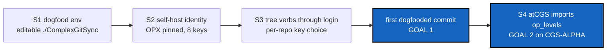

# Dogfooding — develop atCGS through `@cgs`, on the CGS-ALPHA where both OpFrontiers meet

*Created: 2026-11-03*

*Branch: CGS-ALPHA*

> **Owner direction — 2026-11-03:** *"I need to be able to dogfood atCGS as I did
> with ComplexGitSync. CGS-ALPHA will be the branch on which the OpFrontier of
> cgitsync and atCGS merge. This needs to be done very quickly. What is the
> fastest route to achieve those two goals?"*

## Abstract — read this first

**The one-line version.** Goal 1: develop atCGS with atCGS. Every commit and
push of this workspace goes through `pixi run '@cgs' <LAYER> login …`, with ssh
keys from the GLYPH and none from `~/.ssh`. Goal 2: on `CGS-ALPHA`, atCGS stops
redefining the levels and imports ComplexGitSync's OpFrontier (`op_levels`). One
definition, one environment, one branch.

**Why it is quick.** Most of it already exists:

- This workspace *is* already a cgitsync tree. It was bootstrapped from
  `ComplexGitSync/examples/cgs-opx.cgs`: project `ComplexGraphSync`, branch
  `CGS-ALPHA`, 8 repos, atCGS at the root, ComplexGitSync nested. You already
  commit it with `pixi run cgitsync commit`. Dogfooding means putting `@cgs` in
  front of that, not building a new tree.
- Both repos are already on `CGS-ALPHA`. ComplexGitSync's side of the
  OpFrontier is already there: `orchestre/op_levels.py` (`LEVELS`, `PoE`,
  `LevelCommand`, `Leaves`, LinkAtCGS § 6–7). It is also already in atCGS's
  pinned 8.6.2, and that pin is an ancestor of `CGS-ALPHA`.
- The identity layer (1.6.0-alpha) already opens a session, loads the GLYPH's
  keys into a private agent and runs `cgitsync <op>` through it.

**The fastest route** (§ 2): S1 environment → S2 identity → S3 verbs → **first
dogfooded commit** (goal 1, about half a day) → S4 OpFrontier merge (goal 2),
itself developed dogfooded.

**What you will find.** § 1 what blocks today, § 2 the route, § 3 decisions,
§ 4 refusals, § 5 acceptance.



## 1. What blocks dogfooding today

| # | Blocker | Where |
|---|---|---|
| B1 | `@cgs` and `cgitsync` run the **pinned 8.6.2** from git, not the `CGS-ALPHA` checkout in `./ComplexGitSync` (8.7.0). A change on one side is invisible to the other until the pin moves. | `pixi.toml [pypi-dependencies]` |
| B2 | `login` lets through only `bootstrap, initialise, status, view-tree, env, release …`. There is no `add`, `commit`, `push`, `fetch` or `pull`, so the everyday loop can't run through `@cgs`. | `atcgs/__init__.py` `CORE_OPERATIONS`, `_identity_request` |
| B3 | `login` writes `TWIN.cgs` into the current directory. Run from the workspace root, that is a stray file in atCGS's own repo. | `commands.login` |
| B4 | **GitHub deploy keys and one agent don't mix.** With 8 repos, the agent holds 8 deploy keys. ssh offers the first one, GitHub accepts it as a deploy key *for another repo*, then refuses the push. The key must be chosen per repo. | `session.py` |
| B5 | `ssh` also tries `~/.ssh/id_*`, so a dogfooded push could succeed with the owner's personal key and prove nothing. | `Session.env` |
| B6 | No OPX key is pinned, no register exists for this workspace, and no GLYPH key is installed on GitHub. | owner, `spec/contracts.toml` |
| B7 | **Two OpFrontiers disagree on the same codes.** ComplexGitSync's `PoE` gives OPX `0000`, DEV `1000`, USR `1100`, PUB `1111`; atCGS's role codes give OPX `1000`, DEV `1100`, USR `1110`, PUB `1111`. The level names agree; the bits don't. | `op_levels.LEVELS` vs `atcgs.commands.ROLE_CODES` |
| B8 | **Two naming rules for level files.** `LevelCommand.of("cgs", "OPX")` says `cgitsync bootstrap cgs-opx.cgs`; atCGS ships `examples/cgs-opx.cgs` (underscore) on purpose (ALPHA.md). | `op_levels.LevelCommand`, ALPHA.md |

## 2. The route

### S1 — One environment over both CGS-ALPHA checkouts (30 min)

- Split the pin into two Pixi features, because a feature cannot override a
  dependency the default environment also declares (tested 2026-11-03: Pixi
  reports "conflicting URLs"):

  ```toml
  [feature.pinned.pypi-dependencies]
  complexgitsync = { git = "https://github.com/flipoyo/ComplexGitSync.git", rev = "<CGS-ALPHA head>" }
  [feature.dogfood.pypi-dependencies]
  complexgitsync = { path = "./ComplexGitSync", editable = true }
  [environments]
  default = ["pinned"]   # a plain atCGS clone (POEX.cgs) still installs
  dogfood = ["dogfood"]  # this workspace: both repos live
  ```

  This layout solved in a scratch project. In the dogfood environment, a
  change in `./ComplexGitSync` is live in `@cgs` at once.
- Move the default pin from 8.6.2 to the `CGS-ALPHA` head (`dd3472b`, 8.7.0,
  already on origin).
- `tests/test_layers.py`: the pin check reads `feature.pinned`; a new check
  says `dogfood` is an editable path to `./ComplexGitSync`.
- Tasks run as `pixi run -e dogfood '@cgs' …`. `require_pixi` needs no change:
  the project root is the same.

### S2 — Self-host the identity (1 h, mostly the owner)

1. `ATCGS_AUTHORIZE=OPX pixi run -e dogfood '@cgs' OPX init`, copy `idpub` into
   `spec/contracts.toml [identity] opx_pub`, run it again.
2. Register: `.cgitsync/.memory/.register`, the default (D4). It is versioned in the
   `.memory` repo, so a `cgitsync commit`/`push` backs it up.
3. `pixi run -e dogfood '@cgs' OPX request req.json` with the 8 repos of the
   tree, each `OPX`. Then `OPX admit req.json`.
4. `scripts/deploy_keys.py` (new, M7-lite): reads the access journal and
   **prints** one `gh repo deploy-key add` per grant (`--allow-write` for
   OPX/DEV). The owner runs them; nothing calls GitHub on its own. The full
   M7 stays in `github-deploy-keys.md`.

### S3 — The everyday verbs through `login` (2 h)

- B2: allow per level, the remote enforcing the rest:
  `USR`: `status, view-tree, fetch, pull`;
  `DEV`: those plus `add, rm, commit, push, branch, checkout, merge`;
  `OPX`: those plus `tag, release …, bootstrap, initialise, omniscience, memory`.
  `_identity_request` and `tests/test_identity_layer.py::SelectorTests` follow.
- B3: `login` writes `TWIN.cgs` only for `bootstrap`/`initialise`, otherwise
  into the session's own directory, never into a tracked repo.
- B4: `Session` writes each granted key's **public** half into its 0700
  directory and an `ssh` wrapper as `GIT_SSH_COMMAND`. The wrapper reads the
  repo from the remote command (`git-receive-pack 'flipoyo/atCGS.git'`) and
  runs `ssh -o IdentitiesOnly=yes -o IdentityFile=<that repo's .pub>`. ssh
  then signs with the matching key held in the agent; no private key is
  written.
- B5: the same wrapper sets `-F /dev/null` plus the user's `known_hosts`, so
  `~/.ssh` keys and config are never used.
- `scripts/local_remote.py` gains a second bare repo, to prove the
  per-repo key choice against sshd without GitHub.

**→ Goal 1:** `pixi run -e dogfood '@cgs' OPX login ComplexGraphSync commit "…"`
then `… push`. The push succeeds with GLYPH keys only, and the same push with
`ssh-add -D` beforehand fails.

### S4 — Merge the OpFrontiers on CGS-ALPHA (2–3 h, dogfooded)

- atCGS imports `LEVELS` and `LevelCommand` from
  `ComplexGitSync.orchestre.op_levels`. `PRIME_CGS` becomes `tuple(LEVELS)`,
  and the role codes come from the `PoE` vectors (D1). No level is defined
  twice.
- `@cgs OPX login TWIN bootstrap` runs the command `LevelCommand.of` names, so
  the level file's name follows one rule (D2).
- The level-file spec this workspace is built from moves to atCGS (D3), and
  a test on each side checks that the other side's copy agrees:
  ComplexGitSync's `test_molonari_opfrontier.py` style, applied to atCGS.
- `spec/contracts.toml [identity] codes` and `contract-inspect` read their
  codes from `op_levels`; README § 2 and § 3 and TUTO 05 follow.
- Land in both repos on `CGS-ALPHA` with one `cgitsync commit`/`push`
  across the tree, run through `@cgs`.

**→ Goal 2:** one level definition (ComplexGitSync's), used by both, on
`CGS-ALPHA`.

## 3. Decisions for the owner

| # | Question | Proposal |
|---|---|---|
| D1 | Which 4-bit codes are canonical (B7)? | **Decided 2026-11-03: ComplexGitSync's `PoE`** — *"cgitsync is right, OPX is POE"*: OPX `0000`, DEV `1000`, USR `1100`, PUB `1111`. atCGS's codes go in S4. |
| D2 | Level file names: `cgs-opx.cgs` or `cgs_opx.cgs` (B8)? | **Decided 2026-11-03: the dash**, as `LevelCommand` says. The owner accepted the consequence: `NamedCgs` (LinkAtCGS §7) reads `cgs-<level>.cgs` as branch `<level>` with fallback `CGS-ALPHA`, so each level file says `default_branch = "<level>"`. Applied in 1.7.1-alpha. |
| D3 | Where does the spec of this workspace live? Today it is `ComplexGitSync/examples/cgs-opx.cgs`. | In atCGS (`examples/`), since atCGS is the tree's root. ComplexGitSync keeps a pointer or a copy checked by test. |
| D4 | Where does the register live? | **Decided 2026-11-03: in `.cgitsync/.memory`** — *"the register belongs to atCGS, not .cgitsync"*, then: a register per project, in its own memory: `.cgitsync/.memory/.register`, the default of `@cgs`. Its anonymous projection goes to `.omniscience` later. |
| D5 | ssh keys: one deploy key per repo, or one account key for OPX? | Deploy keys, with S3's per-repo choice: it is what DEV/USR users will need anyway. |

## Progress — 2026-11-03

- **S1 done.** `pixi.toml`: features `pinned` (git, CGS-ALPHA head `dd3472b`,
  8.7.0) and `dogfood` (editable `./ComplexGitSync`); `pixi run -e dogfood`
  imports ComplexGitSync from `./ComplexGitSync/src`. Tests pass in both
  environments.
- **S3 done.** `LOGIN_OPS` per level (B2); `TWIN.cgs` only for
  `bootstrap`/`initialise` or a bare login (B3); the session's ssh wrapper
  (`GIT_SSH_COMMAND`) offers each repo its own key and never `~/.ssh` (B4,
  B5). `local-remote` now serves two repos whose keys open their own repo only:
  plain ssh is refused as "a deploy key of flipoyo/demo, not of flipoyo/other",
  and the session's ssh reaches both.
- **S2, code part done:** `pixi run deploy-keys` prints one `gh api …/keys`
  per active grant. **Owner's part to do:** `OPX init` (twice, pinning in
  between), `OPX request` for the 8 repos, `OPX admit`, run the printed
  `gh api` commands. Then the first dogfooded commit closes goal 1.
- **S4 done, except D2.** `atcgs.PRIME_CGS` is `tuple(LEVELS)` and `ROLE_CODES`
  is the PoE of `ComplexGitSync.orchestre.op_levels`: OPX `0000`, DEV `1000`,
  USR `1100`, PUB `1111`. `spec/contracts.toml`, README § 7 and TUTO 05 follow;
  a test checks both. The workspace spec moved to `examples/ComplexGraphSync.cgs`
  (plain project, validated by cgitsync, checked against ComplexGitSync's copy).
  Not done: `@cgs <LAYER> login TWIN bootstrap` does not yet go through
  `LevelCommand.of`; ComplexGitSync's own tree is unchanged.
- **D2 resolved (1.7.1-alpha).** The level trees are `examples/cgs-{opx,dev,usr}.cgs`,
  each validated by cgitsync. Earlier note, kept for the record: Dash level files do not validate: `NamedCgs`
  makes `cgs-opx.cgs` mean branch `opx`. Either keep the underscore (`cgs-opx.cgs`,
  working today), or change LinkAtCGS §7 so the dash names the level and not a
  branch. The level trees keep the underscore until then.

## Closing — 2026-11-05

- **S4 finished.** A bare `@cgs <LAYER> login TWIN bootstrap` runs the command
  `LevelCommand.of(TWIN, LAYER)` names (`bootstrap <twin>-opx.cgs` ...): one rule
  for the level file's name.
- **ComplexGitSync mounted at OPX and DEV**, at `./ComplexGitSync` on `CGS-ALPHA`:
  it is the dogfood environment's editable path. USR does not mount it;
  `.cgitsync` is still never a mount. The 1.0.1-alpha ban predated S1.
  `test_layers` and ALPHA.md follow.
- **S2 done by the owner.** OPX pinned in `spec/contracts.toml`
  (uid `35c65c66…d104`), enrolled in `.cgitsync/.memory/.register`; one request
  for the 10 repos of `cgs-opx.cgs`, each `OPX`, admitted; 10 deploy keys
  installed from `pixi run deploy-keys`.
- **Keys proven:** `@cgs OPX login ComplexGraphSync fetch` fetched 10/10 with
  the session's agent and wrapper only (`agent_keys = 10`, `cgitsync = 0`).
- **The OPX tree moved to its level branch.** `cgs-opx.cgs` names branch `opx`
  (D2), which existed nowhere, so every repo sat on its fallback and the commit
  preflight refused. `@cgs OPX login ComplexGraphSync checkout opx` created it:
  atCGS on `opx`, ComplexGitSync on `cgs_opx` (behind_gate), the private repos
  on `cgs_opx`, `.memory` on `ComplexGitSync_cgs_opx`. `CGS-ALPHA` receives
  this work by a merge from `opx`.
- **Negative proof (B5).** The owner's own ssh reaches GitHub as `Hi flipoyo!`
  (personal key, `~/.ssh/config`), so a push working proves nothing by itself.
  Under the session's rules (`-F /dev/null`, `IdentitiesOnly=yes`, no agent) and
  no session key, `git ls-remote` on atCGS is refused: `Permission denied
  (publickey)`, exit 128; `ssh -G` offers only the session's IdentityFile.
  GitHub's `last_used` shows the 10 `atCGS OPX` deploy keys used at
  2026-11-05T10:51Z, the `@cgs … fetch`.
- **Goal 1:** this closing is committed and pushed with
  `pixi run -e dogfood '@cgs' OPX login ComplexGraphSync commit|push --all`.

## 4. Refusals

- No `~/.ssh` key or config in a dogfooded git operation (B5): if it works only
  with the owner's key, dogfooding is not done.
- No automatic GitHub call: `deploy_keys.py` prints, the owner runs.
- No second copy of the levels in atCGS after S4.
- No editable path in the **default** environment: a plain atCGS clone must
  still install.

## 5. Acceptance

- `pixi run -e dogfood python -c "import ComplexGitSync; print(ComplexGitSync.__file__)"`
  points into `./ComplexGitSync/src`.
- The first commit of this ticket's own closing is made and pushed with
  `pixi run -e dogfood '@cgs' OPX login ComplexGraphSync commit|push`, the
  session's agent holding the GLYPH keys only.
- `local-remote` passes with two repos and per-repo keys.
- After S4: `grep -n '"OPX", "DEV", "USR", "PUB"' atcgs/` finds nothing;
  `pixi run test` passes in both repos, in the dogfood environment.
- On closing: stamp `YYYYMMDD_Dogfooding_DevPlanTicket.md`, move it to
  `.archive/`, one commit message across the tree.
