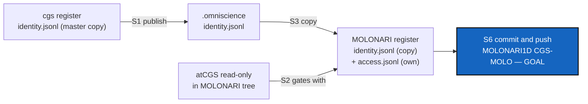

# MolonariCgsMolo — administer `flipoyo/MOLONARI1D` on `CGS-MOLO` through `@cgs`

*Created: 2026-11-05*

*Branch: CGS-ALPHA*

> **Owner direction — 2026-11-05:** *"Goal: pixi run cgs operational. I
> registered flipoyo as OPX in cgs register. There is nothing in omniscience
> yet. Write a devPlanTicket to be able to run @cgs with pixi. The goal is to
> administrate github.com:flipoyo/MOLONARI1D CGS-MOLO branch with cgs."*
>
> Then: *"the gitRepo atCGS will be included in MOLONARI.cgs. It will be a
> read-only install of atCGS. This will gate MOLONARI OperatingSpace by
> accessing to the .register of this exact project. But a user once declared
> to atCGS for whatever purpose is known by atCGS and therefore inscribed
> automatically in the local register of the Project."* Source of the
> identities: **the `.omniscience` projection** (decided 2026-11-05).

## Abstract — read this first

**The one-line version.** `molonari.cgs` mounts atCGS, read-only. Its `@cgs`
gates the MOLONARI Operating Space with **MOLONARI's own register**. Identity
is global: whoever atCGS knows, every project knows. OPX publishes the identity
journal to `.omniscience`, and each project's register copies it. Access is per
project: OPX grants MOLONARI's repositories in MOLONARI's register.

**Identity global, access local.**

| Journal | Written where | Copied where | Content |
|---|---|---|---|
| `identity.jsonl` | cgs register only (the master copy) | `.omniscience`, then every project's register, verbatim | UID, IDPUB, proof, OPX's signature: no name, no project |
| `access.jsonl` | each project's own register | nowhere | (UID, repo, role, ssh public key), signed by OPX |

An identity line names no project and is signed by OPX. An exact copy of the
journal is therefore valid in any register that pins the same `opx_pub`, and a
read-only atCGS carries that pin in `spec/contracts.toml`.

**Where we start (verified 2026-11-05).**

- OPX is pinned and enrolled. The cgs register holds 1 identity and 10 OPX
  grants on the cgs tree.
- `@cgs` works end to end on the cgs tree (TUTO 01).
- `.omniscience` is empty: one README, `8b4c85e`. It is private, writable at
  OPX in the cgs tree, on branch `cgs_CGS-ALPHA`.
- atCGS is public. The 6 MOLONARI repositories are public, owned by `flipoyo`
  (admin), and each has a `CGS-MOLO` branch. MOLONARI1D's is at `d059141`.
- The `.memory` repository already has a `MOLONARI1D_CGS-MOLO` branch.
- The MOLONARI tree spec is `ComplexGitSync/examples/molonari.cgs`, written
  for 8.5.0. It validates under 8.8.0 but has no atCGS, `.memory` or
  `.omniscience` mount.

**The route** (§ 2): S1 publish the identities → S2 find the project's register
→ S3 copy the identities into it → S4 `molonari.cgs` with atCGS inside → S5 grant
the keys (owner) → S6 bootstrap and the first commit pushed on `CGS-MOLO`.



## 0. Review of the short tickets

| Short ticket | State on 2026-11-05 | For this ticket |
|---|---|---|
| `github-deploy-keys.md` | **Partly done.** OPX is pinned. Deploy keys are printed and installed by hand; M7 is not built. Its open points "DEV and USR need the journals" and "projecting the identity journal to `.omniscience`" are **answered here** for identities: S1 and S3. | Update on closing: drop the pin line and point the projection at this ticket. M7 stays out. |
| `opx-agentic-mounts.md` | **Mounts done.** The `.omniscience` record definition (hash of NAME, .gts …) is still open. | S1 puts only `identity.jsonl` in `.omniscience`, which is not that record. The two must not collide (D2). |
| `boundary-curl.md` | **Not started.** It waits for the owner's tuples. | Not related. |

## 1. What blocks it today

| # | Blocker | Where |
|---|---|---|
| B1 | **The register is always `<atCGS>/.cgitsync/.memory/.register`.** Inside a MOLONARI tree, atCGS is a mount below the root, so the register must be **the enclosing project's**: `<CGSHOME>/.cgitsync/.memory/.register`. | `commands.REGISTER`, `commands.register` |
| B2 | **No projection.** Nothing writes `identity.jsonl` to `.omniscience`. | — |
| B3 | **No copy.** A project register has no way to take identities it did not enrol itself. Every register starts with its own `OPX init`. | `journal.Register` |
| B4 | **`molonari.cgs` has no atCGS, `.memory` or `.omniscience` mount**, and it mounts ComplexGitSync as a project repository. ComplexGitSync would then follow the tree's branch to `CGS-MOLO`: the misalignment hit on the cgs tree. | `ComplexGitSync/examples/molonari.cgs` |
| B5 | **No key for any MOLONARI repository.** | GLYPH, register |
| B6 | **`login … bootstrap` writes `<TWIN>.cgs` into the current directory**, which would be a stray file. **`deploy-keys` prints every grant**, so the 10 installed keys would fail again. | `Session.write_cgs`, `scripts/deploy_keys.py` |
| B7 | **GLYPH capacity:** 17 keys of about 470 bytes. 10 + 6 = 16: this project fits, a third will not. The GLYPH is per user, not per project. | `glyph.seal` |
| B8 | **`@cgs … commit` keeps one line of the message.** Not blocking. | argument passing |

## 2. The route

### S1 — Publish the identities to `.omniscience` (1 h)

- New verb: `ATCGS_AUTHORIZE=OPX pixi run -m @cgs '@cgs' OPX publish`. It
  copies the cgs register's `identity.jsonl` verbatim to
  `.omniscience/atcgs/identity.jsonl`, plus its chain head, `sha256` of the
  last line, on branch **`CGS-MOLO`** of `.omniscience` (D2).
- **No manual branch switch** (owner, 2026-11-05). The cgs tree's `.omniscience`
  stays on `cgs_CGS-ALPHA`. `publish` opens an OPX session, as `login` does, and:
  1. `git worktree prune`, then `git worktree add` of `.omniscience` on
     `CGS-MOLO`, in the session's 0700 directory. The branch is created from
     `origin/main` the first time.
  2. Writes the two files, commits, and pushes `origin CGS-MOLO` with the
     session's `.omniscience` key.
  3. `git worktree remove`, then closes the session.
  Nothing is written into a tracked checkout; cgitsync never sees the tree move.
- It refuses if the journal does not verify against `opx_pub`, and it does
  nothing if the published head already equals the register's.
- It never publishes `access.jsonl`, a GLYPH or a login.
- Test: publish, tamper one byte of the published copy, reading it refuses.

### S2 — The register of the enclosing project (1 h)

- `register()` resolves `<CGSHOME>/.cgitsync/.memory/.register`. `CGSHOME` is
  the nearest directory at or above atCGS's root that holds `.cgitsync/`, the
  same rule `cgitsync` uses. In the cgs workspace that is atCGS's root, so
  nothing changes there. Inside MOLONARI it is the MOLONARI root.
  `ATCGS_REGISTER` still overrides it.
- `login` refuses when `TWIN` is not the project of that tree. Then
  `@cgs OPX login MOLONARI …` cannot act on the cgs tree, and the reverse holds.
- Tests: atCGS nested one level below a fake project root finds that root's
  register; the twin/project mismatch is refused.

### S3 — Copy the identities into the project register (2 h)

- On every `login`, and on `@cgs OPX admit`, the project register's
  `identity.jsonl` is brought level with `.omniscience/atcgs/identity.jsonl`:
  missing lines are appended verbatim, and the whole result is verified.
- A project copy that has **gone its own way** (a line not in the published
  copy) is refused, never merged.
- **One rule follows:** `enrol` happens only in the master copy, the cgs
  register. In a project register, `OPX init`, `admit` of a new identity and
  `revoke UID` refuse and say where to do it. `admit` of a known UID writes
  **grants only**, into the project's `access.jsonl`.
- An identity revoked in the master copy is revoked in every project at the
  next copy, because the revocation line is copied too.
- Tests: a copy of a copy is equal; a revoked UID cannot log in after the next
  copy; a project-local `enrol` is refused; a copy that has gone its own way is
  refused.

### S4 — `examples/molonari.cgs`, with atCGS inside (1 h)

Copied from ComplexGitSync's spec (Dogfooding D3: the spec lives in atCGS),
then changed:

```toml
project = { name = "MOLONARI", default_branch = "CGS-MOLO", fallback_branch = "main" }
repos = [
  { repository = "github:flipoyo/MOLONARI1D", relative_path = ".", … },        # unchanged
  # … the 5 other MOLONARI repositories, unchanged …
  # the gate: atCGS, read-only; its pixi.toml pins ComplexGitSync (default env)
  { repository = "github:flipoyo/atCGS", relative_path = ".atcgs", default_branch = "CGS-ALPHA", fallback_branch = "CGS-ALPHA", private = true, nested_config = "disabled" },
  # this project's register: its own branch of the shared memory repository
  { repository = "github:flipoyo/.memory", relative_path = ".cgitsync/.memory", fallback_branch = "main", private = true, writable = true, nested_config = "disabled" },
  # the published identities, read-only
  { repository = "github:flipoyo/omniscience", relative_path = ".omniscience", default_branch = "CGS-MOLO", fallback_branch = "CGS-MOLO", private = true, nested_config = "disabled" },  # main after validation (D2)
]
```

- ComplexGitSync is no longer mounted: atCGS's Pixi installs the pinned
  version (B4, D3).
- `tests/test_layers.py`: the file `validate`s. atCGS and `.omniscience` are
  private and read-only, `.memory` is writable, and the 6 MOLONARI repositories
  are on `CGS-MOLO`. A test also checks that ComplexGitSync's copy names the
  same 6 repositories.
- B6 fixes land here: `write_cgs` writes into the session's directory, never the
  current one. `deploy-keys -- --repo …` prints only the named repositories.

### S5 — Grant the keys (owner, 20 min)

```bash
pixi run -m @cgs '@cgs' OPX request molo.json \
  github:flipoyo/MOLONARI1D OPX     github:flipoyo/MOLONARI-API OPX \
  github:flipoyo/MOLONARI-data OPX  github:flipoyo/MOLONARI-hardware OPX \
  github:flipoyo/MOLONARI-gate OPX  github:flipoyo/MOLONARI-computo OPX
pixi run -m @cgs deploy-keys -- --repo github:flipoyo/MOLONARI1D …     # the 6 only
```

`request` puts the 6 keys in your GLYPH: 16 / 17 (B7). The `admit` waits for
S6: it must write into **MOLONARI's** register, which exists only once the tree
is installed. `atCGS`, `.memory` and `.omniscience` are already granted to you
in the cgs register.

### S6 — Bootstrap, admit, first commit (owner, 40 min)

The bootstrap runs from the cgs workspace, so the first `@cgs` is not yet the
gate:

```bash
pixi run -m @cgs '@cgs' OPX login ComplexGraphSync bootstrap examples/molonari.cgs MOLONARI
cd ~/.cgs/MOLONARI-<timestamp>/.atcgs          # from here on, MOLONARI's own gate
pixi install                                    # default environment, pinned ComplexGitSync
ATCGS_AUTHORIZE=OPX pixi run '@cgs' OPX admit ~/.cgs/cgs-20261105060302/molo.json
#   copies the identities from .omniscience, writes the 6 grants into MOLONARI's register
pixi run '@cgs' OPX login MOLONARI fetch        # fetched=9 (6 + 3 mounts)
pixi run '@cgs' OPX login MOLONARI status       # MOLONARI repositories on CGS-MOLO, ALIGNED
# one change in MOLONARI1D, chosen by the owner
pixi run '@cgs' OPX login MOLONARI commit --all "…"
pixi run '@cgs' OPX login MOLONARI push --all   # MOLONARI1D CGS-MOLO, and the register in .memory
```

If `status` shows a misalignment, S4's spec is wrong. Fix the spec; never move
the branches by hand.

**→ Goal:** a commit on `origin/CGS-MOLO` of `flipoyo/MOLONARI1D`, pushed by the
`@cgs` of the atCGS inside the MOLONARI tree. It is gated by MOLONARI's register,
whose identities came from `.omniscience`.

## 3. Decisions for the owner

| # | Question | Proposal |
|---|---|---|
| D1 | Identities: where from? | **Decided 2026-11-05: the `.omniscience` projection.** |
| D2 | Where in `.omniscience`, on which branch? | **Decided 2026-11-05:** `atcgs/identity.jsonl` and `atcgs/identity.head`, on `main` in the end, so a project mounts it read-only on a fixed branch, *"but create a CGS-MOLO for use until we validate the development"*. Until this ticket closes, `publish` writes to branch **`CGS-MOLO`** of `flipoyo/omniscience`, and `molonari.cgs` mounts `.omniscience` on `CGS-MOLO`. Merging into `main` is the closing step (§ 5). Kept apart from the future `.omniscience` record (opx-agentic-mounts). |
| D3 | ComplexGitSync in the MOLONARI tree? | Not mounted: atCGS's Pixi installs it. MOLONARI is never a place where ComplexGitSync is developed. |
| D4 | Which atCGS does MOLONARI run? | **Decided 2026-11-05: `CGS-ALPHA`**, read-only. Its default environment pins ComplexGitSync at `f56d814` (8.7.1), not the 8.8.0 checkout of the dogfood environment. S4 checks the MOLONARI tree with that pin. |
| D5 | GLYPH capacity (B7)? | Accept 16 / 17 here. Before a third project: one GLYPH per project, or a larger GLYPH version. A short ticket. |
| D6 | `pixi run cgs` without the `@`? | Keep the one name `@cgs`. |

## 4. Refusals

- No `enrol` outside the master copy. A project register only copies identities.
- No `access.jsonl`, GLYPH or login in `.omniscience`: identities only.
- No `~/.ssh` key or config in any MOLONARI git operation.
- No automatic GitHub call: `deploy-keys` prints, the owner runs.
- No write to atCGS or `.omniscience` from the MOLONARI tree.
- No `@cgs` operation on one tree while `TWIN` names the other.

## 5. Acceptance

- On `.omniscience` branch `CGS-MOLO`, `atcgs/identity.jsonl` equals the cgs
  register's and verifies against `opx_pub`.
- Inside the MOLONARI tree, `@cgs` uses `~/.cgs/MOLONARI-*/.cgitsync/.memory/.register`,
  whose `identity.jsonl` equals the published one and whose `access.jsonl` holds
  the 6 MOLONARI grants only.
- A project-local `enrol` is refused; a UID revoked in the master copy cannot
  log in to MOLONARI after the next copy.
- `fetch` on the MOLONARI tree: `"cgitsync": 0`; no stray `.cgs` in atCGS.
- A commit on `origin/CGS-MOLO` of MOLONARI1D, pushed through MOLONARI's `@cgs`.
- `pixi run test` passes in both environments.
- On closing: merge `.omniscience` `CGS-MOLO` into `main` and switch
  `molonari.cgs` to mount `.omniscience` on `main` (D2); stamp
  `YYYYMMDD_MolonariCgsMolo_DevPlanTicket.md`, move it to `.archive/`, update
  `github-deploy-keys.md`.

## Progress — 2026-11-05

- **S1 done.** `@cgs OPX publish` (`commands.publish`): verifies the master
  identity journal, writes `atcgs/identity.jsonl` and `atcgs/identity.head` on
  branch `CGS-MOLO` of `.omniscience` from a throwaway worktree in a private
  directory, pushes with the session's `.omniscience` key, removes the worktree.
  Tested against a local bare remote: the tree's checkout never moves, nothing
  but identities is published, a second run changes nothing, an OPX without a
  grant on the remote is refused.
- **S2 done, with one change.** `project_root()` is the nearest directory at or
  above atCGS holding `.cgitsync/`; the register is that project's. The master
  register is where atCGS is that root. The twin/project guard of the ticket
  is replaced by a guard on `CGSHOME`: `TWIN` is only the name of the `.cgs`
  (the cgs workspace is project `cgs`, its twin is `ComplexGraphSync`), but
  `cgitsync` obeys `CGSHOME`, so `login` refuses when it names another tree.
- **S3 done.** `sync_identities` runs on `login` and `admit`: verbatim copy,
  verified against `opx_pub`, refused when the project holds a line the
  published copy lacks. In a project register `OPX init`, `publish`, `revoke UID`
  and `admit` of an unknown identity are refused (`Unauthorized`, exit 3);
  `admit` of a known one writes grants only.
- **S4 done.** `examples/molonari.cgs`: the 6 MOLONARI repositories on
  `CGS-MOLO`, atCGS at `.atcgs` (`CGS-ALPHA`, private, read-only), `.memory`
  writable, `.omniscience` read-only on `CGS-MOLO`; ComplexGitSync not mounted.
  `DECLARED` under both the pinned 8.7.1 and the dogfood 8.8.0. B6 fixed:
  a bare `login` writes `TWIN.cgs` in `INIT_CWD` (where the command was typed),
  refused in atCGS's root; `bootstrap` writes nothing. `deploy-keys --repo`
  prints only the named repositories.
- **To do, owner:** S5 and S6. First `publish`, then `request`, then the
  bootstrap. MOLONARI1D's `.gitignore` on `CGS-MOLO` must list `.atcgs`,
  `.cgitsync/` and `.omniscience` before the bootstrap: that is the change for
  the first administered commit. B7 (GLYPH 16 / 17) and B8 are as stated.

## Progress — 2026-11-05, S5 and S6 run

**Goal reached.** Commit `56dd11d` is on `origin/CGS-MOLO` of
`flipoyo/MOLONARI1D` (3 lines of `.gitignore`), committed and pushed by
MOLONARI's own `@cgs` (the read-only atCGS at `.atcgs`, 9 GLYPH keys, register
`MOLONARI-20261105131200/.cgitsync/.memory/.register`). The register is on
`flipoyo/.memory`, branch `MOLONARI_CGS-MOLO` (`0b27808`). The other five
MOLONARI repositories were not touched.

What the run changed in the plan:

- **Order.** The ticket had the bootstrap go through `@cgs` from the cgs
  workspace. A session there holds the 10 cgs keys only. The install is a plain
  `pixi run cgitsync bootstrap examples/molonari.cgs MOLONARI`; the grants
  (`admit`) and the deploy keys (`deploy-keys --repo`) come after, from the
  MOLONARI tree. `.memory` needed its branch: answer `y` to the install's offer.
- **Keys.** 6 new keys (GLYPH 16 / 17); the gate repositories (atCGS,
  `.omniscience`, `.memory`) reuse the 3 keys already installed, granted in
  MOLONARI's register from `molo-gate.json` (public data). A session reaches
  only repositories it holds a key for, read-only mounts included.
- **Spec fix.** `examples/molonari.cgs` declared an `environment`: the install
  rebuilt MOLONARI1D's `pixi.lock`. Removed, and a test keeps it out.
- **`.gitignore`.** cgitsync wrote `.atcgs`, `.omniscience` and `MOLONARI.lgr`
  into MOLONARI1D's `.gitignore` itself: no manual step.

Follow-ups, not done:

1. **A plain atCGS clone cannot `pixi install`/`pixi run`** (the `dogfood`
   environment's editable `./ComplexGitSync` is re-solved and missing). It
   needs `PIXI_FROZEN=true` or `--frozen`. Breaks the Refusals line "no
   editable path in the default environment".
2. **Stray branch** `ComplexGitSync_MOLONARI_CGS-MOLO` on `flipoyo/.memory`
   (`ee601f2`, an empty copy of `main`). The install's `memory branch` offer
   named it; `checkout` then used `MOLONARI_CGS-MOLO`. Delete it when sure.
3. **Closing (D2):** merge `.omniscience` `CGS-MOLO` into `main` and mount
   `main` in `molonari.cgs`, once the development is validated; then stamp and
   archive this ticket and update `github-deploy-keys.md`.
4. **Next admission** of a user: `OPX publish` in the cgs workspace, then
   `OPX admit` in MOLONARI; revocation: `OPX revoke UID` in the cgs workspace,
   `publish`, and the next `login` in MOLONARI copies it.
5. B7 (GLYPH 16 / 17) and B8 (one-line commit messages) stand.

## Follow-ups — 2026-11-05, later

1. **Pixi in a plain clone: documented, not fixed.** The lockfile records the
   `dogfood` environment's editable `./ComplexGitSync`; without that folder
   even `--locked` reports "lock-file not up-to-date". README § 1, TUTO 03 § 8
   and `molonari.cgs` say `PIXI_FROZEN=true` + `pixi install -e default`. The
   real fix is to move `dogfood` into a second manifest, which changes every
   `pixi run -e dogfood`: owner's call.
2. **Stray `.memory` branch deleted** (`ComplexGitSync_MOLONARI_CGS-MOLO`, same
   commit as `main`, unprotected, no PR). `MOLONARI_CGS-MOLO` (the register) and
   `main` untouched.
3. **TUTO 05** written from this run. D2's closing step is still open.

## Two manifests, promote, up-to-date branches — 2026-11-05

- **`@cgs/pixi.toml`** (owner: *"putting dogfood in a second manifest
  corresponds to declare @cgs"*): the development Operating Space, with
  `./ComplexGitSync` editable; tasks are the root's, run from atCGS's root.
  `pixi run -m @cgs '@cgs' …` replaces `pixi run -e dogfood '@cgs' …`. The root
  `pixi.toml` has no feature or environment any more and never names the
  checkout: a plain clone installs with `pixi install` (verified in a copy
  without `./ComplexGitSync`). `PIXI_FROZEN` is no longer needed. A test keeps
  both manifests equal but for the ComplexGitSync source.
- **Pin moved** from `f56d814` (8.7.1) to `47d4100` (8.8.0), the ComplexGitSync
  `CGS-ALPHA` head; the root lock no longer holds an editable path.
- **`@cgs OPX login TWIN promote DIR FROM TO`**: fast-forwards branch TO of the
  one repository at DIR to FROM on its remote, with that repository's key;
  anything else refused. For promotions cgitsync cannot do from this tree
  (ComplexGitSync behind the gate is moved only on `cgs_<branch>`).

## Closing — 2026-11-05

- **Goal reached:** MOLONARI1D `CGS-MOLO` is administered through `@cgs`, from
  the read-only atCGS in the MOLONARI tree, gated by MOLONARI's own register
  whose identities come from `.omniscience`. First administered commit
  `56dd11d`.
- **One command:** `pixi run cgs …` (1.8.0-alpha). `scripts/cgs.py` hands over
  to `@cgs/pixi.toml` where `./ComplexGitSync` is checked out, and runs the
  pinned ComplexGitSync anywhere else (`ATCGS_PINNED=1` forces it).
- **Branches level:** atCGS `main` = `opx` = `CGS-ALPHA`; ComplexGitSync
  `main` = `CGS-ALPHA` = `cgs_CGS-ALPHA` = `47d4100`, via `OPX promote`.
- **Carried over:** D2's closing step (merge `.omniscience` `CGS-MOLO` into
  `main`, mount `main` in `molonari.cgs`) moves to the short ticket
  `omniscience-identities-main.md`; it waits for the owner's validation.
  B7 (GLYPH 16 / 17) and B8 (one-line commit messages) stand.
