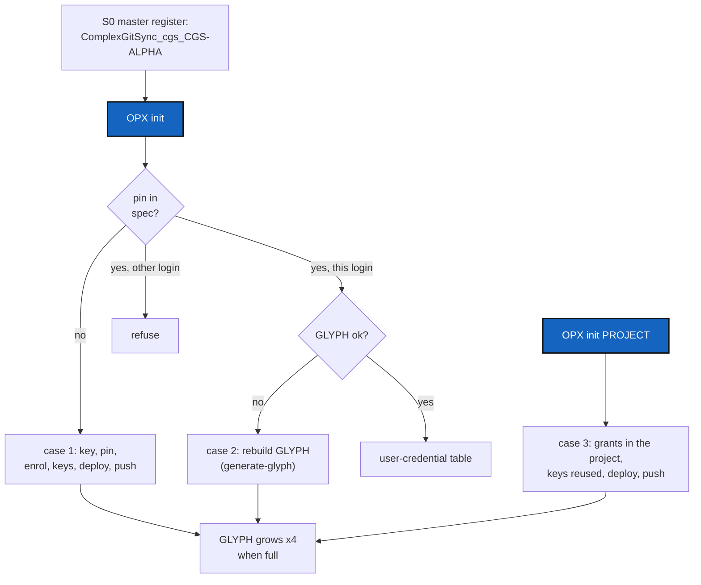

# FluidOPX — becoming OPX, on a first machine, on another machine, and in a project: one command each

*Created: 2026-11-06*

*Branch: CGS-ALPHA*

> **Owner direction — 2026-11-06:** *"I cannot pin anything. The writing in register.toml can be
> automatized in append mode. The install procedure must be simplified, this is too complex.
> 1. OPX distant is declared with the first local keys at CGS level (must load atCGS in OPX, it's a bit
> weird). Then the register .toml must be automatically handled. At this step already 10 keys in the
> GLYPH, so not much space left for other projects. 2. From another local machine, regenerate the GLYPH
> for OPX already declared. Again must deal with cgs-opx.cgs and the same problem with register.toml.
> 3. At the project (ex molo_hrdw.cgs) level declare OPX. The number of keys in a glyph is too limited
> for implication in a lot of projects, so relax the 256x256 constraint on GLYPH by an automatic size
> growth of a 4-time factor if GLYPH too small. The main idea is a fluid user experience."*

> **Owner direction — 2026-11-06 (3):** *"cgs-alpha.cgs as the single file."* D1, D3–D6 answered
> the same day (§ 3).
>
> **Owner direction — 2026-11-06 (2), on D2:** *"Stay on one CGS-ALPHA branch (alpha series), which
> limits the total number of branches; we would not deal with OPX [as a branch]. Step 1: remove
> cgs-opx, dev, usr. Do step 2, the one not to miss, at the start of the ticket, asking for credentials
> if needed."*

## Abstract — read this first

**The one-line version.** The Owner never edits a file and never chains commands by hand. One
command reads the state of the machine and does what is missing:

```bash
pixi run cgs OPX init                  # this machine becomes an OPX machine, whatever its state
pixi run cgs OPX init MOLO-HRDW        # ...and the Owner is OPX of this project
```

| The machine is | `OPX init` does |
|---|---|
| **new atCGS, no key pinned** (case 1) | makes the key, writes the pin, enrols, asks for the keys of the workspace's repositories, admits them, installs the deploy keys, commits and pushes the pin and the register |
| **key pinned, this login matches, GLYPH missing or incomplete** (case 2, today) | says "already OPX", then rebuilds the GLYPH: takes a copy if given, else new keys for the grants already held, registers and GitHub updated (what `generate-glyph` does) |
| **all in order** | prints the `user-credential` table, changes nothing |
| **key pinned, another login** | refuses: there is one OPX, and it is not this login |
| `OPX init PROJECT` (case 3) | in the project's tree: grants the Owner on its repositories, reusing every key the GLYPH already has for the same repository and role, new keys only for the rest, deploy keys, push |

And the GLYPH grows by itself: 8 KiB, then 32 KiB, then 128 KiB, when the keys no longer fit.

**What happened on 2026-11-06.** In a freshly installed workspace `~/.cgs/cgs-20261106170958`,
`ATCGS_AUTHORIZE=OPX pixi run cgs OPX init` answered `identity entry 2: UID mismatch or already known`:

- the key **was already pinned** (`spec/contracts.toml`, `opx_pub = "qL1F…DMo="`, committed on
  2026-11-05) and the register cloned from `.memory` already held the Owner's enrolment as line 1.
  `init` tried to write it again. The login and password were right: a wrong pair stops earlier with
  `does not match the pinned OPX key`;
- nothing told the Owner that the next step was "rebuild the GLYPH" (case 2), and the command that
  does it, `generate-glyph`, **was not there**: `cgs-opx.cgs` installs atCGS on branch `opx`, which is
  still at `9b9974d` (1.9.1-alpha), while `CGS-ALPHA` is at `42c893e` (1.12.0-alpha);
- the GLYPH of 2026-11-05 held 10 keys (one per repository of `cgs-opx.cgs`), out of about 17.

**What you will find.** § 1 blockers, § 2 the route (S0 first: the master register), § 3 decisions, § 4 refusals, § 5 acceptance.



## 1. What blocks today

| # | Blocker | Where |
|---|---|---|
| B1 | **`init` is not idempotent.** Run where the register already holds the Owner's enrolment, it tries to enrol again and fails with a journal error the Owner cannot read. | `commands.init`, `Register.init` |
| B2 | **The pin is a hand edit.** The first `init` prints `idpub`; the Owner copies it into `spec/contracts.toml`, runs `init` again, then must remember to commit and push the file so every gate learns the key. TUTO 1 A3 needed three rewrites. | `commands.init`, `spec/contracts.toml` `[identity] opx_pub` |
| B3 | **Five commands after the pin.** `request` the 10 repositories by hand, `admit`, `deploy-keys`, run the printed `gh` lines, `login … fetch`. | TUTO 1 A4 |
| B4 | **The level branch is behind** (decided away in D2). `cgs-opx.cgs` installs the workspace on branch `opx` (D2 of the Dogfooding ticket), which nothing moves forward: a new workspace runs 1.9.1 while `CGS-ALPHA` has 1.12.0. | `examples/cgs-opx.cgs`, `origin/opx` |
| B5 | **A second machine has no path.** Same pin, same register, no GLYPH: no command says "you are already OPX, rebuild your GLYPH", and the workspace must be installed first (`cgs-opx.cgs`), which is "loading atCGS in OPX". | TUTO 1 Part A |
| B6 | **Project OPX is five commands too** (TUTO 1 B3): `request` (new keys even for repositories the GLYPH already has a key for), `admit`, `deploy-keys`, `gh`, `login … fetch`. | TUTO 1 B3 |
| B7 | **The GLYPH is full early.** 8 159 bytes of plaintext hold about 17 Ed25519 keys (~470 bytes each). The workspace takes 10; MOLO-HRDW adds its own; a second project does not fit. | `atcgs/glyph.py` `GLYPH_BYTES`, `spec/contracts.toml` `[glyph] shape, bytes` |
| B8 | **Keys are not shared between registers when they could be.** A deploy key belongs to one repository; the same (repository, role) in two registers (atCGS USR in every project, omniscience, .memory) can carry the same key, but `request` always makes a new one. | `commands.request`, TUTO 1 B3 |

## 2. The route

### S0 — The master register on one branch: done first, checked on 2026-11-06 (no credential needed)

The master register is the `.register/` folder of the workspace's memory branch in `flipoyo/.memory`.
With the workspace on `CGS-ALPHA` (D2), that branch is `ComplexGitSync_cgs_CGS-ALPHA`; until now new
workspaces were installed on `ComplexGitSync_cgs_opx`. Missing this step would make the next `init`
start a second, empty master, or write enrolments that the published copy does not have (and every
project would then refuse it: *differs from the published one*).

Read on 2026-11-06, with the atCGS 1.12.0 code, from GitHub over https (public, no credential):

| Branch of `.memory` | Identity lines | Grants | Valid against the pin | Note |
|---|---|---|---|---|
| `ComplexGitSync_cgs_opx` (2026-11-05, `39a1bb7`) | 1: the Owner | 10, the Owner's | yes | what both local workspaces are on |
| `ComplexGitSync_cgs_CGS-ALPHA` (2026-11-05, `dca65f0`) | 2: the Owner, then `e9b6c66e…` (the test DEV, `OPX enrol`) | the same 10 | yes | **the master** |
| `ComplexGitSync_ComplexGraphSync_CGS-ALPHA` (2026-11-03) | — | — | — | no register: never the master |

- `CGS-ALPHA`'s identity journal **extends** `opx`'s line for line, the access journals are **identical**,
  and its identity journal is **byte-identical to the published one** (`omniscience`, branch
  `CGS-MOLO`, `atcgs/identity.jsonl`). Nothing has to be copied: `ComplexGitSync_cgs_CGS-ALPHA` *is*
  the master register.
- What remains, in this ticket:
  - the workspace tree is project `cgs` on `CGS-ALPHA` (S0b), so a new install lands on that memory
    branch by itself;
  - `init` and `onboard` refuse a master register whose identity journal is not a prefix of the
    published one, or shorter than it (this check would have caught `cgs_opx`);
  - the two local workspaces on `cgs_opx` (`~/.cgs/cgs-20261105162719`, `~/.cgs/cgs-20261106170958`) are
    retired: nothing must be enrolled from them. They hold no unpushed register line (checked: clean,
    both at `39a1bb7`);
  - **credentials, at the end only (S8):** deleting the stale branches `opx` (atCGS) and
    `ComplexGitSync_cgs_opx` (`.memory`), and `cgs_opx` (ComplexGitSync) if it exists. Your GLYPH is
    lost, so this goes through your own GitHub access (`gh`, or your `~/.ssh` key), after the new
    workspace has pushed once from `CGS-ALPHA`.

### S0b — The level trees go: one workspace tree, project `cgs`, on `CGS-ALPHA` (2 h)

- Remove `examples/cgs-opx.cgs`, `cgs-dev.cgs`, `cgs-usr.cgs` (Owner direction, step 1). Their names forced
  a level branch (ComplexGitSync's `NamedCgs` reads `cgs-<level>.cgs` as branch `<level>`, LinkAtCGS §7);
  `dev` and `usr` never existed on GitHub, only `opx`.
- Add `examples/cgs-alpha.cgs`, the one workspace file (Owner, 2026-11-06): the content of `cgs-opx.cgs`,
  project `cgs`, `default_branch = "CGS-ALPHA"`, no fallback. `NamedCgs` leaves it alone: its rule takes
  only a suffix of exactly three characters (`opx`, `dev`, `usr`), and `alpha` has five (checked in
  ComplexGitSync's `tree/named_cgs.py`). Project `cgs` keeps the memory branch `ComplexGitSync_cgs_CGS-ALPHA` (S0) and ComplexGitSync
  behind the gate on `cgs_CGS-ALPHA`. `examples/ComplexGraphSync.cgs` stays what it is (not the master).
- What the level files carried moves elsewhere: the DEV and USR trees were only used to say "a DEV gets
  these repositories, a USR these": that is the role template of `request --register` (1.10.0).
- Follow: `tests/test_layers.py` (the three level files, the `default_branch == layer` rule),
  `tests/test_atcgs.py`, `tests/test_build_name.py`; `login TWIN bootstrap` (it runs
  `LevelCommand.of`, `bootstrap <twin>-<level>.cgs`): refuse it with a message naming `examples/cgs-alpha.cgs`;
  REFERENCE § 3 and § 9, ALPHA.md, TUTO 1 Part A.
- A test: `examples/cgs-alpha.cgs` is project `cgs` on `CGS-ALPHA`, so its memory branch is
  `ComplexGitSync_cgs_CGS-ALPHA`.

### S1 — `OPX init`, case 1 and the idempotent cases (3 h)

- Read the state first: is a key pinned (`opx_pub`)? does the typed pair give it? is the Owner
  enrolled in this register? does the GLYPH open and hold the keys of the grants (`credential.collect`)?
- **No key pinned:** derive the key (login, password asked twice), write the pin (S2), enrol, then, for
  every repository of the workspace's tree (`examples/cgs-alpha.cgs`), make a key, seal the GLYPH, grant, install the deploy keys
  (`onboard.GitHub`), commit and push the pin (atCGS) and the register (`.memory`). One password, one `y`
  after the plan.
- **Pinned, this pair, enrolled:** never write the enrolment again (B1). Go to case 2 if the GLYPH is
  missing or incomplete, else print the `user-credential` table and stop.
- **Pinned, another pair:** refuse, as today.
- `--plan` prints the plan and writes nothing; every step can be run again (as `onboard`).

### S2 — The pin is written by atCGS, in append mode (2 h)

- The pin moves to its own file, `spec/opx.toml`, written only by `init` and only by appending:
  ```toml
  # atCGS OPX: the key every register trusts. Written by `@cgs OPX init`; never edited by hand.
  [[pin]]
  opx_pub = "qL1FhYN4yQrRd6/cOa92zPG6rsu2t8JXirlntzsYDMo="
  uid     = "35c65c668cb895b0fff2e5ca094bbc465ee27f5cf43159a6ca72f33ed161d104"
  since   = 2026-11-05
  ```
  The last `[[pin]]` is the key in force; earlier ones stay as history (a future key rotation appends).
- `opx_pub()` reads `spec/opx.toml`, else `spec/contracts.toml [identity] opx_pub` (today's pin, read
  once and migrated by the next `init`), else `ATCGS_OPX_PUB` for tests, as now.
- `contract-inspect` and `test_contracts` follow; the pin leaves `contracts.toml` once migrated (D1).
- `init` commits `spec/opx.toml` and pushes it on `CGS-ALPHA` through the session, so every gate gets it.

### S3 — One branch for the alpha series (1 h)

- No level branch any more (D2): the workspace, the gates (`.atcgs` of each project) and every DEV work on
  `CGS-ALPHA`. The OPX merge dance (`opx` → `CGS-ALPHA`, then `checkout`) disappears.
- What `opx` gave, a buffer before the gates see a change, is replaced by a check: `OPX login … push` of
  atCGS refuses when `pixi run test` fails in the tree.
- `init` refuses to run from an atCGS older than `origin/CGS-ALPHA` and says `git pull` (the case of
  2026-11-06: a workspace at 1.9.1 while `CGS-ALPHA` was at 1.12.0).

### S4 — Case 2: another machine, OPX already declared (2 h)

- `OPX init` on a machine with the pin and the register but no GLYPH runs the `generate-glyph` flow
  (1.12.0): `--from PATH` takes a copy; otherwise new keys for the grants already held, registers
  rekeyed, new deploy keys, registers pushed, old deploy keys removed.
- Installing the workspace is part of it (B5): from a plain atCGS clone, `OPX init` finds no workspace,
  shows the `bootstrap` it will run (`examples/cgs-alpha.cgs`), runs it after the `y`, and goes on inside it. The
  Owner never types `cgitsync bootstrap` for the workspace (D3).

### S5 — Case 3: `OPX init PROJECT` (2 h)

- Finds the project's tree (newest `~/.cgs/<PROJECT>-*`, or installs it: same as S4), then grants the
  Owner as OPX on each repository of the project's `.cgs`.
- **Reuses keys** (B8): for each (repository, role), the key the GLYPH already holds for it is granted
  again; a new key only for a repository the Owner had none for. MOLO-HRDW then costs one new key
  (MOLONARI-hardware), not four.
- Deploy keys for the new ones, the register committed and pushed (`onboard.push_register`), the memory
  branch created when it is missing (the `Run it now? (y/N)` of `bootstrap`, answered by the plan).

### S6 — The GLYPH grows by a factor 4 when full (3 h)

- Sizes: level 0 = 256x256 bits = 8 KiB (today), level 1 = 512x512 = 32 KiB, level 2 = 1024x1024 =
  128 KiB, and so on (each ×4).

  | Level | Side | Bytes | Ed25519 keys, about |
  |---|---|---|---|
  | 0 | 256 | 8 192 | 17 |
  | 1 | 512 | 32 768 | 69 |
  | 2 | 1024 | 131 072 | 278 |

- `seal` picks the smallest level the keys fit in; `reseal` grows the GLYPH when a new key does not fit
  and never shrinks it (a shrink would tell how many keys left). The size tells only the level, never
  the number of keys: the plaintext stays zero-padded.
- `open_glyph` accepts every level: the level is read from the file length (a power-of-4 multiple of
  8 192). The header and the version byte stay (D4).
- `to_pbm` draws the side of the level. `spec/contracts.toml [glyph]` says `shape = [256, 256]` as the
  smallest level and the growth rule; `contract-inspect` checks it; REFERENCE § 6 follows.

### S7 — Docs and tests (3 h)

- TUTO 1 Part A becomes three lines (case 1), plus "on another machine" (case 2); Part B3 becomes
  `OPX init PROJECT`. The pin, the `request` lists and the `deploy-keys` lines leave the tutorial.
- Tests: each state of S1 (no pin, pinned and enrolled, pinned and another login, GLYPH missing,
  GLYPH in order); the pin file appended, never rewritten, and read before `contracts.toml`; S5 reuses
  keys (one new key for MOLO-HRDW); S6: 18 keys seal at level 1, 70 at level 2, a GLYPH of each level
  opens, a level-0 GLYPH of 2026-11-05 still opens, a truncated file is refused; the whole of case 1 and
  case 2 against local bare remotes and the fake `gh`, one password each.

### S8 — Remove the stale branches (credentials) (½ h)

Once a workspace installed from `examples/cgs-alpha.cgs` has pushed once on `CGS-ALPHA`: ask the Owner, then
delete `refs/heads/opx` of atCGS, `refs/heads/ComplexGitSync_cgs_opx` of `.memory`, and
`refs/heads/cgs_opx` of ComplexGitSync when present, with `gh api -X DELETE repos/flipoyo/<repo>/git/refs/heads/<branch>`
after checking each is an ancestor of, or no newer than, its `CGS-ALPHA` counterpart.

## 3. Decisions for the owner

| # | Question | Proposal |
|---|---|---|
| D1 | Where does the pin live? You wrote "register.toml". | **Decided 2026-11-06: `spec/opx.toml`**, a file of its own, written only by `init`, in append mode (`[[pin]]` blocks, the last in force). Not in the register (it is checked against the pin); `contracts.toml` keeps the rules, not the key. |
| D2 | The workspace's level branch `opx` lags behind `CGS-ALPHA` (B4). | **Decided 2026-11-06: one branch, `CGS-ALPHA`, for the alpha series.** The level files `cgs-{opx,dev,usr}.cgs` are removed (S0b), the master register is the one of `ComplexGitSync_cgs_CGS-ALPHA` (S0), `opx` is deleted at the end (S8). |
| D3 | Must the Owner install the workspace (`cgs-opx.cgs`) by hand? ("must load atCGS in OPX, it's a bit weird") | **Decided 2026-11-06: yes, `OPX init` installs it** (`examples/cgs-alpha.cgs`) when it is missing, after showing the `bootstrap` line in its plan and a `y`. The workspace is still needed: it holds the master register. |
| D4 | GLYPH growth: a new format version, or the same format at other sizes? | **Decided 2026-11-06: same format, version 1, size by level.** The level is read from the file length; 8 KiB GLYPHs open unchanged, no migration; a GLYPH never shrinks. |
| D5 | Should keys be shared between registers (S5, B8)? | **Decided 2026-11-06: yes, for the Owner now** (`OPX init PROJECT` reuses the Owner's keys for the same repository and role). A key is never shared between two repositories (GitHub refuses it). |
| D6 | `onboard`'s newcomers: reuse keys across projects too? | **Decided 2026-11-06: later.** `request --register` already shares a key within one request; sharing across separate requests of a newcomer is out of scope. |

## 4. Refusals

- No hand edit of any file in the procedure: not the pin, not a `.cgs`, not a register.
- No second enrolment, no second pin for the same key: a re-run changes nothing.
- No GLYPH overwritten that this login cannot open; no GLYPH shrunk.
- No GitHub write before the plan is shown and confirmed.
- No key shared between two repositories.

## 5. Acceptance

- S0 holds: the workspace installed from `examples/cgs-alpha.cgs` sits on `ComplexGitSync_cgs_CGS-ALPHA`,
  its register reads 2 identities and 10 grants, and equals the published identities.
- `examples/cgs-{opx,dev,usr}.cgs` are gone; `pixi run cgitsync validate examples/cgs-alpha.cgs` prints `DECLARED`.
- On a machine with only Pixi, git, `gh` and an atCGS clone: `pixi run cgs OPX init`, one password,
  one `y`, and `user-credential` shows every row `ok`. No file was edited by hand.
- On the Owner's machine today (pin and register present, GLYPH missing): the same command says
  "already OPX", rebuilds the GLYPH, and `user-credential` shows every row `ok`.
- `pixi run cgs OPX init MOLO-HRDW` makes **one** new key (MOLONARI-hardware) and reuses the others.
- A GLYPH with 18 keys is 32 KiB and opens; the GLYPH of 2026-11-05's format (8 KiB) opens unchanged.
- TUTO 1 Part A is three lines; `pixi run test` and `pixi run lint` pass.
- On closing: stamp `YYYYMMDD_FluidOPX_DevPlanTicket.md`, move it to `.archive/`.

## Closing — 2026-11-06

Done in 1.13.0-alpha (not yet run on the real repositories; tested with local bare remotes and a fake `gh`):

- **S0.** The master register is `ComplexGitSync_cgs_CGS-ALPHA` (checked: nothing to copy). The guard S0 asked
  for is `credential.retired_branch`: a workspace whose memory branch ends in `_opx`, `_dev` or `_usr` is never
  taken as the master, by `OPX init` or `OPX onboard`; the two local workspaces on `cgs_opx` are now ignored.
- **S0b.** `examples/cgs-alpha.cgs` is the one workspace file; `cgs-{opx,dev,usr}.cgs` are removed; a bare
  `login TWIN bootstrap` is refused with a message naming it; tests, ALPHA.md, REFERENCE follow.
- **S1, S4, S5.** `atcgs/ownerinit.py`: `OPX init [PROJECT] [--plan] [--from PATH]` (cases 1, 2 and 3), one
  login and password, one `y`; the workspace or the project is installed when missing (https, no key).
  The error of the day (`identity entry 2: UID mismatch or already known`) cannot occur: an enrolled Owner is
  never enrolled again, and a pinned machine without a GLYPH rebuilds it.
- **S2.** `atcgs/pin.py`, `spec/opx.toml`: append-only `[[pin]]`, the last in force; the old line of
  `contracts.toml` is migrated into it and still read when there is no pin file.
- **S3.** `init` refuses an atCGS behind `origin/CGS-ALPHA`; a push of atCGS itself is refused while its
  tests fail (`cmd.tests_before_push`, skip with `ATCGS_SKIP_TESTS=1`). Not done: the DEV and USR sides of that buffer.
- **S6.** The GLYPH grows by 4 (8 KiB, 32 KiB, 128 KiB, up to level 4), never shrinks, same format and
  version 1, read from the file length; old GLYPHs open unchanged.
- **S7.** TUTO 1 Part A and B3, REFERENCE, README, ALPHA.md; `tests/test_ownerinit.py`, glyph growth tests.
- **Deviations.** `init` pushes the register with a plain git commit on the memory branch (no cgitsync memory
  fold), as `onboard`. `OPX init PROJECT` does not create a missing memory branch (the `Run it now?` of
  `bootstrap` is left to the bootstrap). D6 stays for later.
- **S8 not done: it needs the Owner.** Deleting the stale branches (`opx` of atCGS, `ComplexGitSync_cgs_opx`
  of `.memory`, `cgs_opx` of ComplexGitSync if it exists) is an outward-facing GitHub change, to be confirmed
  and run with the Owner's own access once a workspace installed from `examples/cgs-alpha.cgs` has pushed once.
