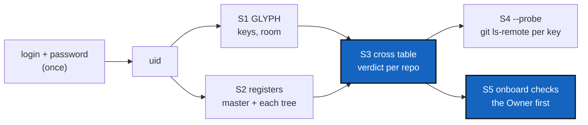

# UserCredential — one command that shows what atCGS knows of you: identity, GLYPH, grants, GitHub

*Created: 2026-11-06*

*Branch: CGS-ALPHA*

> **Owner direction — 2026-11-06:** *"Write a DevPlanTicket for listing the GitRepo ssh keys that are
> known for any user. It must be explained in step A of TUTO 1. Before creating a new user, verify your
> credential. cgs user-credential"*

## Abstract — read this first

**The one-line version.** Any user, the Owner first, types one command, from any directory:

```bash
pixi run cgs OPX user-credential          # or DEV, USR: the word only labels the prompts
```

It asks the login and password once, writes nothing, and prints, for that identity: the uid; where
the GLYPH is and how full it is; every ssh key it holds (repository, role, fingerprint); every
register on this machine that knows the uid (the workspace's master register, each installed
project tree) with the grants there; whether each grant has its key in the GLYPH; and, with
`--probe`, whether GitHub accepts each key. The verdict per repository is one word: `ok`,
`not admitted`, `no key`, `revoked`, `refused by GitHub`.

**Why now.** On 2026-11-06 the Owner could not answer "which repositories am I registered on?":

- The one-liner of TUTO 1 step A read `.cgitsync/.memory/.register/access.jsonl` from the current
  directory. Typed in the development checkout `~/Programmes/atCGS`, it failed
  (`FileNotFoundError`): the master register is in the workspace `~/.cgs/cgs-20261105162719`, and
  each project tree (`~/.cgs/MOLO-HRDW-20261106101948`) has its own.
- **No GLYPH was found on the machine.** `~/.cgs/.glyph/` does not exist, `ATCGS_GLYPHS` is unset,
  and no `*.glyph` file is under `/home`, `/tmp` or `/var/tmp`. Yet the master register holds ten
  OPX grants for uid `35c65c66…d104`, and MOLO-HRDW holds the Owner's grants too. Every `login` will
  answer `no GLYPH for this login/password on this machine`. Nothing today tells the Owner this
  before a command fails, and nothing says it before they admit a newcomer (TUTO 1 C5 needs the
  GLYPH for its sessions).

**Rule it sets.** *Before creating a new user, verify your credentials.* `OPX onboard` (and the
manual `admit`) start by the same check for the Owner, and stop if the Owner's own credentials are
not `ok` on the trees the run touches.

**What you will find.** § 1 blockers, § 2 the output, § 3 the route, § 4 decisions, § 5 refusals,
§ 6 acceptance.



## 1. What blocks today

| # | Blocker | Where |
|---|---|---|
| B1 | **The GLYPH cannot be read.** `open_glyph` exists, but no command lists what a GLYPH holds: which repositories, which roles, which fingerprints, how many of the 17 places are used. | `atcgs/glyph.py` |
| B2 | **The registers are scattered.** One master register in the workspace, one per project tree under `~/.cgs/<PROJECT>-<ts>/`. A user does not know which trees they are in, nor which tree a command reads (`project_root` depends on where atCGS sits). | `commands.project_root`, `register` |
| B3 | **A missing GLYPH, or a key missing from it, shows only at `login`.** `no GLYPH for this login/password` or `the GLYPH holds no key for … matching the granted one`, mid-command. | `commands.login`, `session._keys` |
| B4 | **Orphan keys.** A key requested (in the GLYPH) but never admitted takes one of the 17 places for nothing, and nobody sees it. | `commands.request` |
| B5 | **GitHub is a blind spot.** A grant in a register works only if the deploy key is on GitHub. Listing a repository's deploy keys needs admin rights, so a DEV or USR cannot check; the Owner checks by hand with `gh api`. | `deploy_keys.py`, TUTO 1 C5 |
| B6 | **The tutorial's check depends on the current directory** and reads only the access journal of one register: it misses the identity (enrolled or revoked), the GLYPH and GitHub. | TUTO 1 step A |

## 2. The output

```text
$ pixi run cgs OPX user-credential
OPX login: …   OPX password: …
uid      35c65c668cb895b0fff2e5ca094bbc465ee27f5cf43159a6ca72f33ed161d104   (atCGS OPX: the pinned key)
glyph    ~/.cgs/.glyph/35c65c66….glyph   MISSING                       ← B3: nothing below can log in
         keys 0 / 17

register                                   identity   grants
master   ~/.cgs/cgs-20261105162719          enrolled   10
MOLO-HRDW ~/.cgs/MOLO-HRDW-20261106101948   enrolled   4
published .omniscience (CGS-MOLO)          listed

repository                          role  fingerprint        glyph  master  MOLO-HRDW  verdict
github:flipoyo/atCGS                OPX   SHA256:HqwTmd…     —      grant   grant      no key
github:flipoyo/MOLONARI-hardware    OPX   SHA256:Y31s0f…     —      ·       grant      no key
github:flipoyo/.claude              OPX   SHA256:…           —      grant   ·          no key
…
```

- One row per (repository, role) that is in the GLYPH **or** granted in any register found.
- `verdict`: `ok` (granted, key in the GLYPH with the same fingerprint), `no key` (granted, key not
  in the GLYPH), `not admitted` (in the GLYPH, granted nowhere: an orphan, B4), `revoked` (the
  identity or the grant was revoked), `refused by GitHub` (`--probe` only).
- `--json` prints the same as one JSON object, for scripts and for `onboard`.
- No private key, no password, no login is ever printed.

## 3. The route

### S1 — Read the GLYPH (1 h)

- `user-credential` asks login and password once (`ask_identity`, no confirmation), derives the
  uid, finds the GLYPH (`glyph_path`, `ATCGS_GLYPHS`), and opens it if it exists.
- Lists `(repo, role, fingerprint)` of each key, and the room: used / 17 (from the GLYPH layout,
  not a constant written twice).
- A GLYPH that does not open with this pair (`GlyphError`) says so: another login or password,
  or a file of someone else.
- `MISSING` is a result, not an error: the command goes on with the registers.

### S2 — Find every register on this machine (2 h)

- The master register: the workspace, found as today when atCGS is its root; from anywhere else,
  the newest `~/.cgs/cgs-*/` (or `ATCGS_TREES`) whose atCGS pins the same OPX key.
- Each project tree: every `~/.cgs/*/` holding `.atcgs` and `.cgitsync/.memory/.register`.
  `--tree PATH` (repeatable) adds or restricts.
- For each: is the uid enrolled, active or revoked; its grants (repo, role, fingerprint). Reads
  through `Register.state()`, so a tampered register is reported as such, not silently skipped.
- The published identities: is the uid in the `.omniscience` checkout of each tree (TUTO 2).
- Works the same from the development checkout, the workspace or a gate: nothing depends on the
  current directory (B6). Uses `ATCGS_PROJECT` (OwnerOnboarding) to read each tree.

### S3 — The cross table and the verdicts (1 h)

- Join S1 and S2 on (repository, role, fingerprint). Print § 2; `--json` for the object.
- Exit 0 when every granted row is `ok`, 1 otherwise, so a script can test it.

### S4 — `--probe`: does GitHub accept each key? (2 h)

- For each `ok` row, run `git ls-remote <remote>` through a session holding that key only (the
  session's ssh wrapper, `-F /dev/null`, never `~/.ssh`). Accepted → stays `ok`; refused →
  `refused by GitHub` (deploy key missing, or revoked on GitHub).
- Read-only and per key, so any user can run it: it needs no admin right (B5).
- The Owner may add `--github`: `gh api repos/o/n/keys` lists the deploy keys of each repository
  they administer and flags keys on GitHub that no register grants any more (left after a revoke).

### S5 — The Owner checks themself first (1 h)

- `OPX onboard` (and `OPX admit`) run the S1–S3 check for the Owner, on the master register and
  on each tree of the run, before the plan is applied: no GLYPH, or an Owner row not `ok` on a
  repository the run needs (`.memory`, `omniscience`), stops it with the `user-credential` table.
- `OPX onboard --plan` shows these rows in its plan.

### S6 — Docs and tests (2 h)

- **TUTO 1 step A** gets a first step, before anything else: *"Before creating a new user,
  verify your credentials: `pixi run cgs OPX user-credential`"*, with the table of verdicts and
  what to do for each. The one-liner of step 4 is replaced by this command.
- TUTO 1 C2 and Part D: the newcomer runs `pixi run cgs <ROLE> user-credential` after admission;
  the troubleshooting table points `no GLYPH` and `holds no key` to it.
- REFERENCE § 5 gains the row.
- Tests: a GLYPH and two registers (master and a tree) in a temporary home: every verdict; a
  missing GLYPH; a wrong password (`GlyphError`); a revoked identity; an orphan key; `--probe`
  with a local remote accepting one key and refusing another (`local-remote`); the output holds
  no private key; the same answer from three different working directories.

## 4. Decisions for the owner

| # | Question | Proposal |
|---|---|---|
| D1 | The name. `@cgs` takes a level first: `pixi run cgs OPX user-credential`. | **`user-credential`**, as asked, after any level (`OPX`, `DEV`, `USR`): the level only labels the prompts. |
| D2 | Without a password, may anyone see the register part for a uid (`user-credential UID`)? | **Yes, register part only.** The registers are in `.memory`, which is public today (TUTO 2); the GLYPH part needs the password. |
| D3 | `--probe` makes one network call per key. Default on or off? | **Off.** On demand, and always in `onboard`'s check of the Owner. |
| D4 | The master register from outside the workspace: which one? | **The newest `~/.cgs/cgs-*/` that pins the same OPX key**, said in the output; `--tree` overrides. |
| D5 | The GLYPH is missing today (§ Abstract). Recreating it means new keys: `request` again, `admit`, new deploy keys, the old ones deleted on GitHub. In this ticket or apart? | **Apart, right after S1–S3**: `user-credential` first shows exactly which grants are dead; the recovery steps then go in TUTO 1 (a "lost GLYPH" section). |

## 5. Refusals

- Never print a private key, a login or a password; never write a file.
- Never use `~/.ssh` for `--probe`: a key works through its own session or not at all.
- No GitHub write.
- No dependence on the current directory.

## 6. Acceptance

- From `~/Programmes/atCGS`, the workspace and a project's gate, `pixi run cgs OPX user-credential`
  prints the same table: the master register's 10 OPX grants, MOLO-HRDW's grants, and today
  `glyph MISSING` with every granted row `no key`.
- After the GLYPH is restored or recreated, every row is `ok`, and `--probe` confirms each on GitHub.
- `OPX onboard` refuses to start while the Owner's own rows on the run's trees are not `ok`.
- TUTO 1 step A starts with the check; `pixi run test` and `pixi run lint` pass.
- On closing: stamp `YYYYMMDD_UserCredential_DevPlanTicket.md`, move it to `.archive/`.
