# OwnerOnboarding — one command for the Owner to enrol, admit, key and push newcomers

*Created: 2026-11-06*

*Branch: CGS-ALPHA*

> **Owner direction — 2026-11-06:** *"This is a nightmare for the Owner. Write a
> DevPlanTicket for automation of C3–C6, based on a list for Owner so that he just
> has to launch an integrated method. It may be split by profile but not necessary."*
>
> **Owner direction — 2026-11-06 (2):** *"New users must send the exact part of the
> toml file to the Owner, so that the Owner stores those files in a folder
> registration. 2026-11-06.toml is then created automatically from those files. Each
> new person who wants to register must receive the exact .toml format to send to the
> Owner."*

## Abstract — read this first

**The one-line version.** Each newcomer sends the Owner **one registration file**, a
`.toml` in a fixed format that atCGS writes for them. The Owner drops these files in
`~/.cgs/registration/`. atCGS builds the day's list from that folder; the Owner
confirms each uid, then runs **one** command from the workspace:

```bash
pixi run cgs OPX intake                       # registration/*.toml → ~/.cgs/intake/2026-11-06.toml
# the Owner checks each uid by phone, sets confirmed = true
ATCGS_AUTHORIZE=OPX pixi run cgs OPX onboard ~/.cgs/intake/2026-11-06.toml
```

It prints the plan, asks the OPX login and password **once**, asks one `y`, then
does TUTO 1 C3 to C6 for every person and every project in the list: enrol, publish,
pull, admit, install the deploy keys on GitHub, commit and push each project's
register. Then it prints, for each newcomer, the exact commands of TUTO 1 Part D.

**Why it is needed.** Today one newcomer on one project costs the Owner about
12 commands in two trees, 4 or more password prompts, and some `gh api` lines to
copy by hand (TUTO 1 C3–C6). A three-person team on MOLO-HRDW and MOLO-TWX is
about 40 commands. One mistake (a forgotten `pull`, the wrong tree, a missed `gh`
line, a push left out) gives the newcomer an error they cannot fix themselves.

**What exists already.** Every step is built and was run on 2026-11-05:
`enrol`, `publish`, `admit`, `deploy-keys` (it prints), `login … pull|commit|push`.
This ticket chains them. It adds no new trust: every register line is still
signed by the one pinned OPX key.

**What you will find.** § 1 what blocks today, § 2 the registration file and the
list, § 3 the route, § 4 decisions, § 5 refusals, § 6 acceptance.

```mermaid
graph LR
    N["S0 newcomer:<br/>request writes<br/>registration .toml"] --> F["Owner's folder<br/>~/.cgs/registration/"]
    F --> L["S0 OPX intake<br/>builds the day's list"]
    L --> U["Owner confirms<br/>each uid"]
    U --> P["S1 plan<br/>no write"]
    P --> I["S2 one OPX identity<br/>password once"]
    I --> E["enrol + publish<br/>master register"]
    E --> A["S3 per project:<br/>pull, admit"]
    A --> K["S4 deploy keys<br/>gh api, idempotent"]
    K --> C["S5 commit + push<br/>the register only"]
    C --> R["S6 report +<br/>message per newcomer"]

    classDef here fill:#1565C0,color:#fff,stroke:#111,stroke-width:2px;
    class P,R here;
```



## 1. What blocks today

| # | Blocker | Where |
|---|---|---|
| B1 | **Two trees.** `enrol` and `publish` only run in the master register (the workspace); `admit` only means something from the project's gate (`~/.cgs/<PROJECT>-<ts>/.atcgs`). Every function finds its register from the location of the atCGS it runs from (`ROOT`, `project_root`), so the workspace's atCGS cannot act on a project tree. | `atcgs/commands.py` `project_root`, `register`, `is_master`, `published_identities` |
| B2 | **One password prompt per command.** `enrol`, `publish`, `admit` and every `login` each call `ask_identity` (Argon2id, 256 MiB): four or more prompts per newcomer per project. | `commands._opx`, `commands.login` |
| B3 | **`login` refuses another tree.** It refuses when `CGSHOME` names a tree other than the one its register belongs to: correct for users, but it blocks the workspace from driving a project's `pull`/`commit`/`push`. | `commands.login` |
| B4 | **Deploy keys are printed, not installed.** `deploy-keys` prints `gh api` lines; the Owner copies and runs them (M7, short ticket `github-deploy-keys`). It does not know which keys GitHub already holds. | `scripts/deploy_keys.py` |
| B5 | **The pull before admit is easy to forget.** Right after `publish`, the project's `.omniscience` is behind: `admit` fails with `enrolling a new identity is done in the master register`. | REFERENCE § 8 |
| B6 | **`commit --all` takes everything.** Step C6 commits every repository of the project tree with changes, not just the register: the Owner's other unfinished work would go with it. | TUTO 1 C6 |
| B7 | **No check of the request against the project.** The Owner reads each `json` to see whether the roles asked are the right ones; nothing compares them with the project's `.cgs`. | `commands.admit` grants what the file asks |
| B8 | **The uid check is by eye.** TUTO 1 C2 asks the newcomer to give their uid by a second channel; nothing compares it with the file. | — |
| B9 | **No fixed format for what a newcomer sends.** Today it is a `.json` (`request`'s output) plus a uid and a role told in a message. The Owner rebuilds who wants what by hand, and the newcomer must type the right `REPOSITORY ROLE` pairs. | `commands.request`, TUTO 1 C2 |

## 2. The registration file and the list

### 2.1 The registration file: one per newcomer, written by atCGS

The newcomer never writes it by hand: `request` writes it, in the exact format. The
newcomer gives a project and a role; atCGS takes the repositories from the project's
`.cgs` and the template below, so no `REPOSITORY ROLE` pair is typed (B9).

```bash
cd ~/atCGS
pixi run cgs DEV request --register MOLO-HRDW=DEV --name "Bruno" ~/bruno.toml
# several projects: --register MOLO-HRDW=DEV --register MOLO-TWX=USR
```

It asks the login and password as today, seals the private keys in the GLYPH, and
writes `~/bruno.toml`. The newcomer sends **that file, unchanged**, to the Owner.

```toml
# atCGS registration. Send this file, unchanged, to the Owner.
# It holds only public data: your uid, your public key, the public halves of your ssh keys.
# Tell the Owner your uid by another channel (a call): it is how they know this file is yours.
format  = "atcgs-registration/1"
name    = "Bruno"                       # for the Owner's report only; never written to a register
uid     = "e9b6c66e4af7f6896fcba9ae40dae7302c79da03e7e96e8d68bb226f55d501b3"
created = 2026-11-06T10:42:00Z

[ask]                                   # what you ask for; the Owner decides
MOLO-HRDW = "DEV"

[request]                               # what `admit` needs, as in today's .json
pub   = "…base64…"
proof = "…base64…"
keys  = [
  { repo = "github:flipoyo/MOLONARI-hardware", role = "DEV", ssh = "ssh-ed25519 AAAA… atcgs" },
  { repo = "github:flipoyo/.memory",           role = "DEV", ssh = "ssh-ed25519 AAAA… atcgs" },
  { repo = "github:flipoyo/atCGS",             role = "USR", ssh = "ssh-ed25519 AAAA… atcgs" },
  { repo = "github:flipoyo/omniscience",       role = "USR", ssh = "ssh-ed25519 AAAA… atcgs" },
]
```

**Every newcomer receives the format.** Three places, one source:

- `request --register` writes it (above): the normal way.
- `examples/registration.toml` in atCGS (public): the same file with placeholders and
  one comment per field, for whoever wants to read it before running anything.
- TUTO 1 C2 shows it and says: *send this file, unchanged, to the Owner*.

A test checks that the three agree (the example parses with the same reader, the
tutorial's block equals the example). `request` without `--register` keeps today's
`OUT REPO ROLE …` form and `.json` output.

### 2.2 The Owner's folder

```text
~/.cgs/registration/            outside any repository: the files name people
├── alice.toml                  as received, any file name
├── bruno.toml
├── chloe.toml
└── done/2026-11-06/            moved here by a successful onboard (S6)
```

The Owner saves each received file there. Nothing else: no editing, no renaming
needed. A malformed file is reported by `intake`, not silently skipped.

### 2.3 The day's list: built by `OPX intake`

```bash
pixi run cgs OPX intake                     # reads ~/.cgs/registration/*.toml
# wrote ~/.cgs/intake/2026-11-06.toml: 3 person(s), 0 confirmed
```

`intake` reads every file of the folder (not `done/`), checks each one (format
version, `proof` against `pub`, `uid = sha256(pub)`, keys against the template of each
project asked), and writes the list. It needs no password and writes nothing
else. Re-running it the same day rewrites the list and keeps every `confirmed = true`
already set for an unchanged file.

```toml
# ~/.cgs/intake/2026-11-06.toml — built by `OPX intake` from ~/.cgs/registration/
# Check each uid with the person (by phone), then set confirmed = true.
# You may change a role in `grant`; the registration file must still match it (D2).
date = 2026-11-06

[[person]]
name         = "Alice"
registration = "~/.cgs/registration/alice.toml"
sha256       = "…"                       # of the file as intake read it; onboard refuses a changed file
uid          = "3f2a9c…"                  # read the full uid to the person
confirmed    = false                     # set to true after the check (B8, D3)
grant        = { MOLO-HRDW = "OPX", MOLO-TWX = "USR" }   # copied from [ask]

[[person]]
name         = "Bruno"
registration = "~/.cgs/registration/bruno.toml"
uid          = "e9b6c6…"
confirmed    = false
grant        = { MOLO-HRDW = "DEV" }

[[person]]
name         = "Chloé"
registration = "~/.cgs/registration/chloe.toml"
uid          = "71d0ab…"
confirmed    = false
grant        = { MOLO-HRDW = "USR" }

# optional: where a project's tree is, if not the newest ~/.cgs/<PROJECT>-*/
[project.MOLO-HRDW]
tree = "~/.cgs/MOLO-HRDW-20261106101948"
```

The Owner's only manual edit is `confirmed = true` (and, if needed, a role). `onboard`
refuses a person whose `confirmed` is not `true`, and skips them without stopping the
others.

Split by profile is possible (one folder or one list per profile) but not needed: the
role is per person and per project.

**From the role to the grants (B7).** The role is a *profile template* applied to
the project's `.cgs` (its repositories and its three mounts), as in TUTO 1 C2:

| Repository of the project | OPX | DEV | USR |
|---|---|---|---|
| each project repository | OPX | DEV | USR |
| `.cgitsync/.memory` | OPX | DEV | USR |
| `.atcgs` (atCGS), `.omniscience` | USR | USR | USR |

The request file must hold one key for each repository of the template, with that
role. A key it asks for beyond the template is refused (D2).

## 3. The route

### S0 — The registration file and `OPX intake` (3 h)

- `request --register PROJECT=ROLE [--register …] --name NAME OUT.toml`: find
  `examples/<project>.cgs` by project name, apply the template (§ 2), generate the keys
  as today, write the registration file of § 2.1. One reader and one writer for
  `atcgs-registration/1`, in `atcgs/registration.py`.
- `examples/registration.toml`: the format with placeholders and a comment per field.
- `OPX intake [FOLDER]` (default `~/.cgs/registration/`): check every file, write
  `~/.cgs/intake/<today>.toml` (§ 2.3), print one line per file (ok, or why not).
  No password, no `ATCGS_AUTHORIZE`: it reads public files and writes outside any
  repository.
- `_identity_request` accepts the two new forms; `USAGE` and REFERENCE § 5 follow.

### S1 — `OPX onboard LIST --plan`: read, check, print, write nothing (2 h)

- Parse the list. For each person: `confirmed = true`; the registration file exists
  and is unchanged since `intake` (its hash is in the list); its `proof` verifies
  against its `pub`; `sha256(pub)` equals the `uid` of the file **and** the `uid` of
  the list (B8); its keys match the template of each project in `grant` (B7).
- For each project: find its tree (`[project.X] tree`, else the newest
  `~/.cgs/<X>-*/` holding `.atcgs` and `.cgitsync/.memory`); its `.atcgs` pins the
  same `opx_pub`; the tree has no change outside `.cgitsync/.memory/.register` (B6,
  D4).
- GitHub: `gh auth status` works; for each repository, `gh api repos/o/n
  --jq .permissions.admin` is `true`; list the deploy keys already there.
- Print the plan as a table: person, project, repositories, role, new or already
  done (enrolled, granted, key on GitHub). Exit 0 when the plan is clean, 2 with the
  list of problems otherwise.
- `onboard` without `--plan` runs S1 first and stops on any problem.

### S2 — One OPX identity per run (1 h)

- `ask_identity("OPX")` once. The `Identity` is passed down to `enrol`, `publish`,
  `admit` and to each OPX `Session` (B2). The seed stays in memory only; it is
  dropped when the command ends, also on failure.
- `_opx(reg)` becomes `_check_opx(identity, reg)`: same refusal, no prompt.
- After the plan is printed, one confirmation: `Apply this plan? (y/N)`.

### S3 — Act on a project tree from the workspace (3 h)

- `project_root`, `register`, `is_master`, `published_identities`,
  `sync_identities` take an explicit `project: Path` (default: today's search
  from `ROOT`). The workspace's atCGS can then open a project's register (B1).
  The master register stays the only one that `enrol`s.
- An OPX session for a project tree runs `cgitsync` with `CGSHOME=<tree>`. The
  `CGSHOME` check of `login` (B3) compares with the **given** project, not with
  `ROOT`'s; users keep today's refusal.
- Order per run: enrol every new person (master), `publish` once, then per
  project: `pull` (B5), `admit` each person granted there. The OPX session needs
  the Owner's own grants in that project (TUTO 1 B3); a project without them is
  refused at S1.
- Version guard: a project's `.atcgs` may pin an older atCGS. S1 checks that its
  register reads and verifies under the workspace's code; otherwise it stops and says
  which project to update.

### S4 — Install the deploy keys (M7) (2 h)

- For each new grant on a `github:` repository: `gh api repos/o/n/keys -f title=…
  -f key=… -F read_only=…` (write for OPX and DEV, read-only for USR), as
  `deploy-keys` prints today.
- Idempotent: a key whose material is already on that repository is skipped.
  GitHub refuses a key used on another repository; the GLYPH already has one key per
  (repository, role), so that refusal means a wrong request, reported as such.
- `deploy-keys` keeps its print mode (`--print`, today's behaviour) for an Owner
  who prefers to run them by hand.
- `scripts/local_remote.py` and a fake `gh` on `PATH` (tests) model it without GitHub.

### S5 — Commit and push the register only (1 h)

- Per project, through the OPX session: commit `.cgitsync/.memory/.register` alone,
  message `atcgs onboard <date>: <n> grant(s)` (one line, no `'`), then push the
  memory branch. No `--all` (B6).
- If the tree has other changes, S1 has already refused (D4).

### S6 — Report and message per newcomer (1 h)

- One line per (person, project, step): done, skipped (already done) or failed,
  with the reason. A re-run after a failure resumes: every step is idempotent.
- For each person, a short text ready to send, with their own project names filled in:
  install over https (TUTO 1 Part D), `pixi install`, `<ROLE> login <PROJECT> fetch`.
  Written to `~/.cgs/intake/<date>-<name>.txt`, never into a repository.
- A registration file whose every grant is done moves to
  `~/.cgs/registration/done/<date>/`; one with a failure stays in the folder for the
  next `intake`.

### S7 — Docs and tests (2 h)

- TUTO 1: C2 becomes "run `request --register`, send the `.toml` it wrote, unchanged,
  and tell the Owner your uid by phone", with the format shown. C3–C6 become one step,
  "Owner: save the files in `~/.cgs/registration/`, `OPX intake`, confirm, `OPX
  onboard`". The manual commands move to a short "by hand" annex. REFERENCE § 5 gains
  the rows.
- Tests: the registration file round-trips (write, read, verify); the example and the
  tutorial's block equal what `request` writes; `intake` on a folder with one good,
  one tampered (proof), one wrong-template and one malformed file; list parsing and
  refusals (B7, B8, unconfirmed); one prompt for a whole run; a
  two-project run in a temporary workspace with `local-remote` and a fake `gh`;
  re-run after an interrupted S4 completes without duplicates.

### S8 — Optional, same pattern: `OPX offboard LIST`

`revoke` per project (grant) or in the master (identity), `publish`, delete the
deploy keys on GitHub (`gh api -X DELETE …/keys/<id>`), commit and push the
registers. Proposed as a follow-up once S1–S6 are proven.

## 4. Decisions for the owner

| # | Question | Proposal |
|---|---|---|
| D1 | The Dogfooding ticket refused "any automatic GitHub call: `deploy_keys.py` prints, the owner runs". May `onboard` call `gh` itself? | **Yes, after the plan and one `y`.** The plan lists every key it will add; `--plan` and `deploy-keys --print` keep the manual path. |
| D2 | Who decides the role: the request file or the list? | **The list.** The request must match the template of the role in the list; extra keys are refused, missing ones too. |
| D3 | Must the list carry the newcomer's uid (told out of band)? | **Yes**, required. Without it, anyone who sends a file with a proof is enrolled. |
| D4 | The project tree has other uncommitted changes. | **Refuse at S1**, and say which files. No partial commit of the Owner's work. |
| D5 | Where does `onboard` run? | **In the workspace** (master register), acting on the project trees named in the list (S3). |
| D6 | A project tree is missing on the Owner's machine. | **Refuse at S1** and print the `bootstrap` line (TUTO 1 B2). No install inside `onboard`. |
| D7 | Keep a trace of each run? | A run report next to the list, in `~/.cgs/intake/`. Nothing new in the registers: they already record every enrol and grant, signed. |
| D8 | One file to send, or the `.json` plus a message? | **One `.toml`** (§ 2.1): it carries the request inline, the name, the uid and what is asked. The `.json` form stays for scripts. |
| D9 | The registration file carries the uid: is the phone check still needed? | **Yes.** The file's uid only proves the file is consistent, not who sent it. `intake` writes `confirmed = false`; only the Owner sets it to `true`. |
| D10 | Where are `registration/` and `intake/`? | **`~/.cgs/registration/` and `~/.cgs/intake/`**, on the Owner's machine, outside any repository: they hold names. `--folder` overrides. |

## 5. Refusals

- No password or login in the list, in a registration file, or in an argument:
  `getpass` only, once.
- No hand-written registration file: `request --register` writes it, and `intake`
  refuses a file it cannot verify.
- No onboarding of a person whose `confirmed` is not `true`.
- No write before the plan is printed and confirmed.
- No grant the list does not name; no grant on a project the Owner holds no OPX
  grant in.
- No `--all` commit, no force push.
- No second trust root: a project OPX still cannot `onboard` (only the pinned key signs).
- No name of a person in any register or in `.omniscience`.

## 6. Acceptance

- A newcomer runs one `request --register MOLO-HRDW=DEV --name …` and gets a `.toml`
  equal in form to `examples/registration.toml` and to TUTO 1's block.
- Three such files saved in `~/.cgs/registration/` give, with `OPX intake` and no
  password, `~/.cgs/intake/<today>.toml` with three persons, `confirmed = false`.
- `OPX onboard LIST --plan` on the three-person list above prints the plan and
  writes nothing (`git status` clean in the workspace and in each project tree,
  no GitHub call besides reads).
- `OPX onboard LIST` on a real project (MOLO-HRDW): **one** password prompt, **one**
  `y`; then each newcomer, from a fresh machine, runs only TUTO 1 Part D and gets
  `fetched=4 … "closed": true` at their level.
- Running it a second time changes nothing and reports every step as already done.
- `pixi run test` and `pixi run lint` pass; `local-remote` passes with the fake `gh`.
- TUTO 1 C3–C6 is one step.
- On closing: stamp `YYYYMMDD_OwnerOnboarding_DevPlanTicket.md`, move it to
  `.archive/`, and update the short ticket `github-deploy-keys` (M7 done for
  onboarding; revoke side in S8).

## Closing — 2026-11-06

Done in 1.9.1-alpha (not yet run on the real repositories):

- **S0.** `atcgs/registration.py`: format `atcgs-registration/1`, the role template, `intake`;
  `request --register` in `commands.py`; `examples/registration.toml`; a test checks that the
  example, the tutorial's block and what `request` writes have the same shape.
- **S1–S6.** `atcgs/onboard.py`: `OPX onboard LIST [--plan]`. `ATCGS_PROJECT` lets the workspace
  act on a project tree (B1, B3); the OPX identity is derived once and passed to `enrol`, `publish`,
  `admit` (B2); the pull of `.omniscience` is part of the run (B5); `gh` installs the deploy keys, idempotent (B4);
  the register alone is committed (B6); the plan checks roles against the template (B7) and the
  confirmed uid (B8).
- **S7.** TUTO 1 Part C, REFERENCE § 5, `tests/test_onboard.py` (fake `gh`, local bare remotes).
- **Not done:** S8 `offboard`. Deviations: the "no change outside .register" check looks at the
  project's `.memory` only (the one repository the run commits); the register commit is a plain
  git commit on the memory branch, without the cgitsync memory fold; `--plan` needs
  `ATCGS_AUTHORIZE=OPX` like every OPX verb.
- **Next:** run it for real with one newcomer, then archive.
